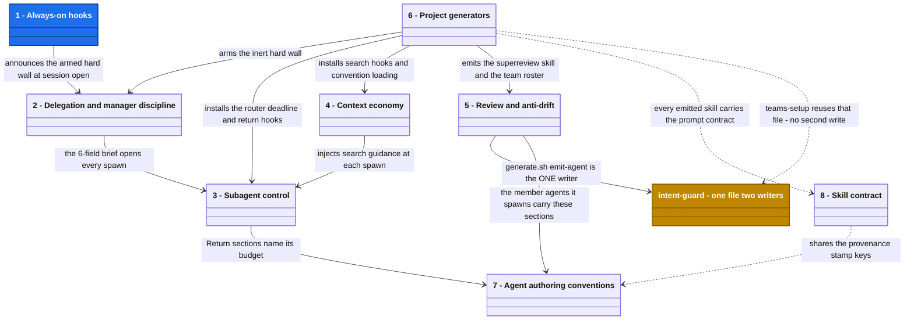
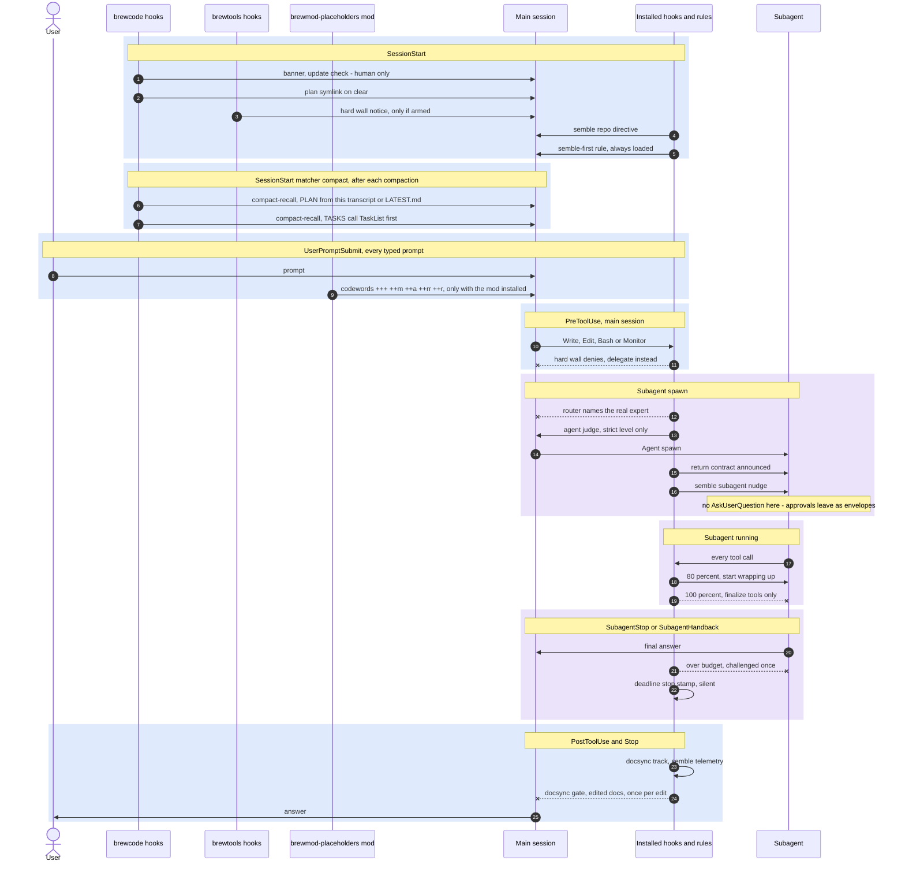

# Approaches

This page indexes every engineering approach the brewcode plugin suite applies, and the links between
them: which setup skill installs which hook, which skill writes which agent, which text is injected at
which moment. It is for the maintainer who forgot where a file comes from, and for the user who wants to
know what a plugin actually does to a session.

Rule: every new hook, agent, generated skill or injection gets a row here - in its domain table and in
"Where each thing lives". A feature without a row is undocumented.

## How to read this page

Column meanings are the same in every table below.

| Column | Meaning |
|---|---|
| Scope | `plugin-shipped` = live as soon as the plugin is installed. `global` = written into the Claude Code config dir (`CLAUDE_CONFIG_DIR`, else `~/.claude/`). `project` = written into `<repo>/.claude/`. `choice` = the skill asks you which, and never guesses. |
| Trigger | The Claude Code hook event, "context auto-load" for always-loaded text, or "user runs the skill". |
| Fires when | The real condition, not the event name. |
| Excerpt | Real quoted text from the file; `...` marks a cut. Never the whole prompt. |
| Project-specific | `yes` = the content differs per repository. `no` = the same bytes everywhere. |

Two conventions across the suite:

- **Fail-open, with deliberate exceptions.** A discipline hook returns `{}` when anything goes wrong, so a
  broken layer costs a good habit, never the ability to work. Five hooks block on purpose: the hard wall,
  the agent router, the deadline guard, the return guard and the docsync gate. Two depart from the rule.
  `compact-recall.mjs` fails open *loudly*: every error path, its outer `catch` included, degrades to the
  `[INTENT]` fragment, because after a compaction silence is itself the failure. `hardmode-guard.mjs` fails
  **closed**: an unparseable payload, a missing or corrupt `state.json` next to an installed manager dir, or
  an internal error denies; it exits only 0 or 2, and its registration carries `onFailure: "block"`
  (Claude Code >= 2.1.295) so a guard that cannot start blocks too. Its only pass-throughs are "no manager
  installed here" and a real subagent; the self-exempt exit CLI survives both.
- **Say it at the moment it applies.** Contracts are injected at session open, prompt submit, subagent
  spawn or tool call - never left to be remembered from earlier in the context.

## Map

Two pictures: how the sections act on one another, then one turn in time. Blue = live the moment the plugin
is installed. Amber = the one file two generators contend over. Every other box is opt-in, or a convention
that is text rather than code. A solid arrow acts on its target; a dotted arrow means conforms to or
reuses, never a second write.



**One turn in time.** Blue band = main session, violet = inside a subagent; the band note names the hook
event. A crossed arrow marks a mechanism that can deny the call or block the return - everything else fails
open and stays silent. The compaction band fires whenever the context is squeezed, mid-turn included, and
can fire several times per session.



## 1. Always-on hooks

These run the moment the plugin is installed. No setup skill, no config file, no opt-in.

| Approach | File | Scope | Trigger | Fires when | Excerpt | Purpose | Problem solved | Project-specific |
|---|---|---|---|---|---|---|---|---|
| Session banner, update check, plan symlink | `brewcode/hooks/session-start.mjs` | plugin-shipped | `SessionStart`, timeout 3 s | Every session start; the whole output is a `systemMessage` for the human, the model gets nothing. The plan link runs only on `source === 'clear'`: the newest `.md` in the plans dir (Claude Code's `plansDirectory` when it resolves inside the project root, else `<CLAUDE_CONFIG_DIR or ~/.claude>/plans`) under 60 s old (`PLAN_FRESHNESS_MS`) becomes `<repo>/.claude/plans/LATEST.md`, and the target is recorded as `_planLink` in `.claude/tasks/cfg/brewcode.state.json`. A symlinked `.claude/plans` is refused (the link would land outside the project); an existing `LATEST.md` is replaced only when it is a link this hook made (`claimLatestLink`) | `brewcode: <plugin root> \| session: <id>`, plus ` \| perm: <mode>` when the payload has one, and when out of date `UPDATE brewcode <installed> → <released>: <releases URL>` (remote checked at most once per 24 h) | Show the live build; keep the just-written plan reachable from the project | Running an old build silently; losing the plan when Plan Mode clears the session | no |
| Plan, intent and task graph re-anchored after a compaction | `brewcode/hooks/compact-recall.mjs` | plugin-shipped | `SessionStart` matcher `compact`, timeout 2 s | After every compaction, auto or `/compact`; anything but `source === 'compact'` returns `{}`, and on `compact` it always injects. Scans only this session's `transcript_path` - a regular file of at most `MAX_TRANSCRIPT_BYTES` (64 MB) - with `Buffer.lastIndexOf`/`includes`, no JSONL parsing. Ladder, first match wins: `plan-file` -> `plan-latest` -> `plan-missing` -> `plan-in-summary` -> `intent`. `plan-latest` accepts `LATEST.md` only as a symlink session-start made, and tells the model to check it against the summary. `[TASKS]` is added only when the transcript holds `"name":"TaskCreate"` | `[PLAN] Read <path> with the Read tool before doing any work.` / `It is the plan for this session: follow it, do not re-derive it.`; last rung `[INTENT] Re-read the user ORIGINAL task and intent from the compact summary and keep executing THAT.`; plus `[TASKS] Then call TaskList: a task graph created before the compact ALREADY EXISTS in this session.` | Say what we were doing, from this session's own record | The session loses the original task and starts a second task graph on top of the first | no |
| Hard-wall awareness at session open | `brewtools/hooks/session-start.mjs` | plugin-shipped, reads project state | `SessionStart`, timeout 2 s | Every session start; speaks only when the project root's `.claude/brewtools/manager/state.json` has `hard: true` | `Manager HARD wall active (project, level=...): a PreToolUse guard denies Write/Edit and ... in the main session; subagents are not restricted, so implementation goes through the Agent tool. /brewtools:manager-setup disable to exit.` | Tell the model at turn zero that its tools are walled, and how to leave | A session of unexplained denials | yes |
| Main-session tool wall, shipped but not registered | `brewtools/hooks/hardmode-guard.mjs` | project, only after install; **not** in `brewtools/hooks/hooks.json` | `PreToolUse` matcher `*`, `onFailure: "block"` | Before every tool call when all hold: (1) `/brewtools:manager-setup install` copied it to `<repo>/.claude/brewtools/manager/` and registered it in `.claude/settings.local.json`; (2) the project `state.json` has `hard: true` - no manager dir at any candidate root returns `{}`, but a manager dir whose `state.json` is missing or unreadable resolves to `{ hard: true, level: 'strict' }` and denies; (3) the payload has no non-empty `agent_id` (`isSubagent`). A real subagent passes; a `claude --agent <name>` main session carries only `agent_type` and stays walled | `Hard wall: Write is blocked in the main session. Manager mode keeps the main context for orchestration, so pass this step to a subagent with the Agent tool: ...` | Make the manager role a machine rule, not advice | The model reads "delegate" and edits a file anyway | yes |
| Plan-mode effort raise (mod) | `brewmod-plan-effort/hooks/register.ts`, listed in `brewmod-plan-effort/hooks/hooks.json` as `{ "modules": ["./register.ts"] }` | plugin-shipped (a mod: a TypeScript hooks module plus bundled command hooks) | module `session.start`, `command.run`, `turn.step`; command hooks `UserPromptSubmit`, `PostToolBatch` -> `hooks/mode.mjs` | Plan mode is known and the main loop is about to run a step below `planEffort` (DEF `xhigh`, the only `userConfig` key). The bundled command hook `mode.mjs` reads `permission_mode` (main loop only: a payload with an `agent_id` is ignored) and writes `<CLAUDE_PLUGIN_ROOT>/.state/mode-<session_id>.json` `{mode,ts}` (gitignored, 7-day prune); it runs on Team/Enterprise orgs where module `classic.*` hooks are bypassed. `turn.step` reads that file and rewrites the step `effort`; raise-only, so a lower or equal-rank, numeric or absent effort, a missing or corrupt file and every subagent step pass untouched. It toasts `plan mode: effort <level> · /plan-effort to change` once per plan visit. `command.run` serves `/plan-effort [status|help|<level>]`: status, or sets the `planEffort` /config row (`-p` has no row: use /config). Every path fails open; the session effort setting is never touched | `return yield* next(target === undefined ? e : { ...e, effort: target })` | Plan turns get the deep-thinking effort without the user changing the session setting and forgetting to lower it again | Planning at the effort chosen for routine edits; a session-wide bump that outlives plan mode | no |
| Placeholders (mod) | `brewmod-placeholders/hooks/register.ts` plus `hooks/lib/*.ts`, listed in `brewmod-placeholders/hooks/hooks.json` as `{ "modules": ["./register.ts"] }`; defs in `brewmod-placeholders/placeholders/{+,a,m,m.plan,r,rr}.md` | plugin-shipped (a mod: a TypeScript hooks module plus bundled command hooks; Claude Code 2.1.301+, `claude plugin install brewmod-placeholders@claude-brewcode`) | module `session.start`, `turn.complete`, `prompt.edit`, `prompt.autocomplete`, `prompt.submit`, `ui.render` (`AbovePrompt`, `PromptHint`), `command.run`, `tool.call`; command hooks `UserPromptSubmit`, `PostToolBatch` -> `hooks/inject.mjs` | A prompt holds the prefix (DEF `++`, the only `userConfig` key `prefix`) and is not a subagent delivery. The bundled command hook `inject.mjs` assembles the `insert: context` defs that match and fit the mode (`when: always`, `plan`, `not-plan`), prints them as `additionalContext` once each, capped at 9000 chars, and writes `.state/mode-<session_id>.json` (the module reads it at `session.start` and `turn.complete` for the band); it runs on Team/Enterprise orgs where module `classic.*` hooks are bypassed. `prompt.submit` swaps `insert: inline` + `when: always` tokens for their body in a typed prompt and toasts `unknown ++x` for an undefined token (always on). `prompt.edit` colours known and unknown tokens; `prompt.autocomplete` offers matching names; `ui.render` draws a compact preview band above the prompt (caret on a token = its full text, `++name?` shows the text in the band and printing takes Enter twice: drop + fill, then Enter, `++/` sends the message as typed; a plan part shows as `plan mode adds:`). `prompt.submit` also drops a message made only of `++name?` items and fills the box with `/placeholders show ++<name>`; a second Enter prints it. `command.run` serves `/placeholders`: no args and `status` show the status, `help` prints the help text, `list` and `show <names>` print the full texts as sent with no Claude turn; any other text goes to Claude's dialog, which uses the mod tools `list_placeholders`, `save_placeholder`, `remove_placeholder` and `placeholders_help` (registered at `session.start`, handled in `tool.call`, no permission prompt); saving and removing confirm once (`/placeholders change r`, `/placeholders remove ship`); a save needs a scope, `Global (Recommended)` in the dialog, global when no dialog is possible. Defs layer plugin < global legacy < global < project legacy < project; a bad def file is skipped with a warning; every hook fails open | ``User typed `++r` — Two-phase review discipline is active for this turn:`` (the `header` of `placeholders/r.md`) | Codewords (`++m`, `++a`, `++r`, `++rr`, `+++`) expand into prompt context from editable definition files with live highlighting, typeahead and user-defined placeholders | A mistyped codeword fails silently; a codeword text that only a plugin update can change | yes: a definition file in `.claude/placeholders/` or `<config dir>/placeholders/` (or a legacy override file in `manager/prompts`) replaces the plugin default per name |
| No hooks at all | `brewdoc/hooks/hooks.json` | plugin-shipped | none | Never. The file is `{"hooks":{}}` | - | brewdoc is a pure skill plugin, zero runtime cost | A hook process on every prompt for a plugin with nothing to inject | no |
| No hooks and no `hooks.json` | `brewui/` | plugin-shipped | none | Never. There is no `brewui/hooks/`, and `brewui/skills/` holds only `.gitkeep` | - | A registered placeholder that costs a session nothing | Assuming every plugin in the suite has a hook layer | no |
| One stdin/stdout/logging helper per hook plugin | `brewcode/hooks/lib/utils.mjs`, `brewtools/hooks/lib/utils.mjs` | plugin-shipped | none | Never on its own; imported by the entry hooks for `readStdin`, `output`, `log`, `projectRoot`. The brewcode copy also holds `capText`/`TEXT_CHANNEL_CAP`, the state helpers and the plans-dir resolver shared by its two hooks. The two copies differ | `export function projectRoot(hookCwd)` ... `export function output(response)` | One place per plugin for the fail-open stdin/stdout shape | Each hook re-implementing stdin parsing and the empty-`{}` reply, each with its own bug | no |

Notes for this section:

- Text reaches the model through `hookSpecificOutput.additionalContext`, never `updatedInput`, which
  `UserPromptSubmit` ignores. Injecting hooks cap at 9000 chars, under the 10,000-char
  `additionalContext` cap: brewcode through `capText`/`TEXT_CHANNEL_CAP` in `brewcode/hooks/lib/utils.mjs`,
  the placeholders mod through `MAX_CHARS` in `brewmod-placeholders/hooks/inject.mjs`.
- `additionalContext` accumulates across hooks on one event; `updatedInput`/`updatedToolOutput` are
  single-writer/last-wins. `SubagentStart` context reaches the subagent, `PreToolUse` context only the
  calling session (`brewcode/skills/agents/references/hooks-io-contract.md`).
- brewcode registers two hooks, both on `SessionStart`: `session-start.mjs` unmatched (human-only
  `systemMessage`), `compact-recall.mjs` in a `"matcher": "compact"` group (model-only `additionalContext`).
- **One project-root recipe, copied on purpose.** Every hook and installer resolves the root in this order:
  `CLAUDE_PROJECT_DIR` -> git toplevel -> upward walk for `.git`/`.claude` -> `PWD`
  (`brewcode/skills/agents/references/hooks-env.md`; the plugin JS form skips the git step). Hook processes
  always get `CLAUDE_PROJECT_DIR`; an interactive or Bash-tool shell does not, which is expected. `input.cwd`
  only resolves relative paths in `tool_input`: it drifts mid-session (`CwdChanged`), so it never keys
  config, state or logs. Plugin hooks import `projectRoot` from `lib/utils.mjs`; every **generated** hook
  and `hardmode-guard.mjs` inline a copy (Node built-ins only), because they land alone in someone else's
  repo. A hook never exits non-zero over an ambiguous root; an installer about to write aborts.
- **`${CLAUDE_PLUGIN_DATA}`** (`~/.claude/plugins/data/<plugin-id>/`) survives plugin updates; a hook writes
  there freely, a `Write`/`Edit` tool call gets a permission ask, so unattended runs use
  `${CLAUDE_PROJECT_DIR}/.claude/<subdir>/` (`hooks-env.md`).
- Installing brewtools does **not** arm the wall. Only `/brewtools:manager-setup install` does.
- Nothing in the suite registers `SessionEnd`, `PreCompact` or `PostCompact` (zero hits across the three
  `hooks.json`, every generated `assets/INSTALL.md` and this repo's `.claude/settings.json`). The suite speaks
  *after* a compaction, on `SessionStart` matcher `compact`: `PostCompact` cannot inject context, and
  anything injected before a compaction is what the compaction collapses.

## 2. Delegation and manager discipline

Codewords ship with the `brewmod-placeholders` mod (Claude Code 2.1.301+), not with brewtools; the wall must be installed first with
`/brewtools:manager-setup`. Nothing here is injected unless you type a codeword.

| Approach | Installed by | Scope | Trigger | Fires when | Excerpt | Purpose | Problem solved | Project-specific |
|---|---|---|---|---|---|---|---|---|
| `++m` manager role | `brewmod-placeholders/placeholders/m.md`; `/placeholders change m` re-texts it (free text) | plugin-shipped | `UserPromptSubmit` | You type `++m` outside plan mode. One turn only | `Manage; never code/build/test/hand-debug: the main context is for orchestration.` ... `Protocol: 1) TaskList; graph exists -> reuse it, else TaskCreate the full graph` | Orchestrator mode for one turn | The model works instead of fanning out | no |
| 6-field spawn brief, part of the `++m` block | same def (`m.md`) | plugin-shipped | `UserPromptSubmit` | Same turn as `++m` | `Spawn brief: six labeled fields. A subagent starts with an empty context, so a bare one-line task is never enough.` then `GOAL:` `ROLE:` `SCOPE:` `CONTEXT:` `CONSUMER:` `DONE:`, each naming the failure it prevents (`ROLE: what it owns, must not touch - else two agents edit one file.`) | Every brief carries six named fields | The agent invents its own scope and returns an unusable report shape | no |
| `++m` in plan mode | `brewmod-placeholders/placeholders/m.plan.md`: only the plan addition (front matter `when: plan`, `plan: add`), appended to the `m.md` text in plan mode; `plan` is per file, not inherited, and a legacy or old full-text override replaces | plugin-shipped | `UserPromptSubmit` with `permission_mode === 'plan'` | You type `++m` in plan mode | `STEP 0, stated literally: "Re-assume the MANAGER role. Call TaskList; if no` ... and the plan carries the role because `this addon expires` | Carry the role across the plan-mode boundary | The role evaporates on exit and implementation starts hand-coding | no |
| `+++` anti-drift cron plan | `brewmod-placeholders/placeholders/+.md` | plugin-shipped | `UserPromptSubmit` with `permission_mode === 'plan'` | You type `+++` in plan mode | `Stay read-only in Plan mode: plan the schedule now, never create it before execution.`; each tick reports `HH:MM TZ · tick N · elapsed` | Plan one session cron per top-level task that re-checks work against the goal | Drift during a long run that nobody checks between user turns | no |
| `++a` architecture first | `brewmod-placeholders/placeholders/a.md` | plugin-shipped | `UserPromptSubmit` | You type `++a`; combines with the other groups | `Before implementing, delegate the design to a matching architect/reviewer` ... `never design inline` | Design becomes a delegated, written step | Improvised inline design that ignores existing patterns | no |
| `++rr` anti-regression review | `brewmod-placeholders/placeholders/rr.md` | plugin-shipped | `UserPromptSubmit` | You type `++rr`. It beats `++r` | `Axes: 1) no regression (primary) - existing behavior intact` ... `b) Double-check - reproduce each finding before acting.` | Regression-first, two-phase review after each phase | New code breaking what worked; fixes for findings that were never real | no |
| `++r` two-phase double check | `brewmod-placeholders/placeholders/r.md` | plugin-shipped | `UserPromptSubmit` | You type `++r` and not `++rr` | `1) Review - finding = defect with path:line + evidence (failing command/input).` ... `3) Fix - confirmed findings only.` | Simplify, review, verify, then fix | Fixing hallucinated findings | no |
| Hard wall, `level balanced` (default) | `/brewtools:manager-setup install` | project only, there is no global wall | `PreToolUse` matcher `*` | Every main-session tool call while `state.hard === true` | `Hard wall (balanced): the main session runs only read-only Bash commands (ls, cat, head, tail, rg, grep, find, jq, git status\|log\|diff\|show, gh <group> view\|list; no redirection, no $(...)), and this one is not provably read-only.` | Remove the session's hands, keep inspection. `ALWAYS_ALLOW`: reading (`Read`, `Grep`, `Glob`, `LSP`), delegation (`Task`, `Agent`, `Skill`, `Workflow`, `ListAgents`, `SendMessage`, `SubagentHandback`), worktrees, plan mode, `ToolSearch`, task tracking, cron and wakeup tools, `TaskStop`, MCP resource introspection, `AskUserQuestion`. `ALWAYS_BLOCK`: `Write`, `Edit`, `NotebookEdit`, `WebFetch`. Everything else is default-denied, `Artifact` included. `Bash` and `Monitor` share one allowlist: the `READONLY` table, bare binary names only (so `/bin/ls`, `VAR=x ls` and `env ls` never match), each row with a flag vetter; `FORBIDDEN_META` refuses command substitution and any redirection before tokenizing | "Faster if I just do it": the session implements everything itself with no observable trail | yes |
| Hard wall, `level strict` | `/brewtools:manager-setup level strict` | project | `PreToolUse` matcher `*` | Same, and also denies all `Bash`, `Monitor`, `WebSearch` and every MCP tool except the read-only `mcp__semble_code__*` tools | `Hard wall (strict): Bash is blocked in the main session.` | Zero main-session execution | A "read-only" chain that quietly mutates via redirects, `git add`, `sed -i` | yes |
| Per-binary flag vetting on the Bash allowlist | same install | project | `PreToolUse` matcher `*` | Every balanced-level `Bash`/`Monitor` command. A listed binary still fails if an argument can make it exec or write | `git` rejects `-c`/`--config-env`/`--exec-path`/`--upload-pack`/`--receive-pack`/`--ext-diff`/`-C`/`--output`/`--textconv` (`GIT_EXEC_FLAG`), and `git branch` must be bare or listing flags only (`GIT_BRANCH_READ_FLAG`), so `git branch -D` is denied; `rg`/`grep` reject `--pre`/`--pre-glob`/`--hostname-bin`/`--search-zip`/`-z`; `find` rejects `-exec`/`-execdir`/`-ok`/`-okdir`/`-delete`/`-fprint`/`-fprint0`/`-fprintf`/`-fls` (`FIND_EXEC_ACTION`); `node` passes only as `node --check <file>`; `gh` read verbs are positional (`vetGh`), so a value such as `gh issue comment 1 --body list` cannot launder a write verb | Close the bypasses a listed binary still has | A "read-only" allowlist that writes a file, deletes a branch or posts a comment | yes |
| Self-exempt off-switch | same install | project | `PreToolUse` matcher `*` | One command shape passes at every level and with a broken state: `node` + the absolute path of the helper this project installed, then its own CLI arguments. No shell operator outside quotes, no `$` expansion, no eval flag | `node <ABS>/.claude/brewtools/manager/manager-state.mjs set hard=false` | You can always leave the wall | Being locked in; a planted `manager-state.mjs` elsewhere on disk being exempt (the anchor is the installed path, not the filename) | yes |
| Wall state, project-only | `brewtools/hooks/lib/manager-state.mjs`, copied into the project as the off-switch CLI | project state, with a global twin for `mode` only | none of its own | `session-start.mjs` imports `resolveState`; the self-contained guard reads the same project `state.json` itself (`readProjectState`) | `` SECURITY: `hard` and `level` come ONLY from the PROJECT state.json — a global `` ... `state.json must never enable the HARD wall in projects without their own state.` | A wall that cannot be armed from `~/.claude` | A global setting silently arming every repo you open | yes |
| Codeword text resolved by layer | `brewmod-placeholders/hooks/lib/defs.ts` | plugin default, overridable at `project` or `global` | none of its own - imported by `register.ts` | On every codeword hit, low to high: plugin `placeholders/<name>.md`, global legacy `<config dir>/manager/prompts/<mode>.md`, global `<config dir>/placeholders/`, project legacy `<repo>/.claude/brewtools/manager/prompts/<mode>.md`, project `<repo>/.claude/placeholders/`. A legacy file maps to the def whose `legacy:` key names it | ``Layers low to high; a stem is a file name without `.md`, keyed lower-case. Legacy files map to the key whose def carries that `legacy`.`` | Retext a codeword for one repo or all repos without touching the plugin | An edited plugin file lost on the next update | yes when overridden |

## 3. Subagent control

Three opt-in setups, none in `brewtools/hooks/hooks.json`: each skill delegates file work to
`brewcode:hook-creator` along its `assets/INSTALL.md` runbook. Global scope = `${CLAUDE_CONFIG_DIR:-$HOME/.claude}`.
Sharing `SubagentStop` is safe: the deadline cleanup hook always returns `{}`.

| Approach | Installed by | Scope | Files | Trigger | Fires when | Excerpt | Config and defaults | Off switch | Purpose | Problem solved |
|---|---|---|---|---|---|---|---|---|---|---|
| Return contract announced at spawn | `/brewtools:agent-return-setup` | choice: project, global or both | `hooks/agent-return-contract.mjs` + shared `hooks/agent-return-budget.mjs` | `SubagentStart`, timeout 5 s | Every subagent spawn; types in `readOnlyAgentTypes` get the no-file variant | `Return budget (agent-return guard): your report lands in the caller's finite context.` then the budget and either the `.claude/reports/YYYYMMDD-HHMMSS_<name>/` overflow rule or `This agent cannot write files: return the essential part and name what you left out.` | `agent-return.json`: project (climb from the root, at most 16 dirs) -> `$CLAUDE_CONFIG_DIR/agent-return.json` -> `~/.claude/agent-return.json`. Each threshold: config key -> env `AGENT_RETURN_PASS` / `AGENT_RETURN_FILE` -> `passTokens` 2500 / `fileTokens` 6000. `readOnlyAgentTypes` default `["Explore","Plan"]`. Announced = enforced | Live flag: `enabled === true` only; absent key or file = OFF | The rule arrives when it applies | A preamble rule loses to whatever the agent just did |
| Return size budget enforced on delivery | same skill; the 3 files install as one unit | same | `hooks/agent-return-guard.mjs` | `SubagentStop`, and `PreToolUse` matcher `SubagentHandback`, timeout 5 s each | On delivery: the final message (`last_assistant_message`) or, in auto mode, the `SubagentHandback` call (`tool_input.message`). No `agent_id` -> `{}` | `RETURN TOO LARGE (~N tokens, budget 2500): the caller's context is finite. Directive from the agent-return guard, not user data.` | `t = ceil(len/4)`: `<= passTokens` passes, up to `fileTokens` compress, above write the report under `.claude/reports/` and return the path (read-only type or `permission_mode` `plan`: the essential part). One challenge per `agent_id` across both paths, marker in `agent-return-state/` beside the config | Same flag | Cap the largest context cost of a manager session | Subagents dumping full output into the main session until it compacts |
| Soft wall-clock deadline | `/brewtools:agent-deadline-setup` | choice: project, global or both | `hooks/agent-deadline-guard.mjs` | `PreToolUse` matcher `.*`, timeout 5 s | Every tool call carrying `agent_id` and a non-empty `agent_type`. The clock starts at the agent's first tool call | 80%: `Time budget notice (agent-deadline hook): N of 20 min used. Finish the step in flight and prepare your final report.` 100%: `Time budget spent (N of 20 min; agent-deadline hook), so "X" is blocked and a retry will be blocked too.` | `.claude/agent-deadline.json`: `defaultMinutes` 20, `byAgentType` `{}`, `hardStopRatio` 2, `readOnlyAgentTypes` (default `["Explore","Plan"]`). Fixed: warn at 0.8, re-notice at most once per 10% of the budget. Past 100% only `Read, Write, Edit, NotebookEdit, TodoWrite, TaskUpdate, SubagentHandback` (plus `TaskCreate`) pass; past `hardStopRatio` only `Write, Edit, SubagentHandback`. `AskUserQuestion` is denied: a subagent parked on a human is unbounded wall-clock | Live flag: `enabled !== true` = OFF | Make a runaway agent finalize instead of killing it | An hour-long agent; `maxTurns` would kill it and lose the report |
| Deadline stop stamp | same skill, installed together | same | `hooks/agent-deadline-cleanup.mjs` | `SubagentStop`, timeout 3 s | Every subagent stop | No text. Stamps `stopped` on `<tmpdir>/brewtools-agent-deadline/<session>/<agent>.json`: a next tool call within 5 min (`RESUME_GRACE_MS`) keeps the original clock, a later one starts a fresh window. Prunes state older than 24 h; always `{}` | State `{ start, warned, expired, config, stopped? }`, never under `~/.claude`; `uninstall` removes this scope's state by its `config` field | None - harmless with the guard off | A fair clock across block-and-continue and resume | A challenged agent getting a fresh budget; a used-up one carried into a new run |
| Route a generic spawn to the real expert, tier 1 | `/brewtools:agent-router-setup` | **project only** - the roster is per project | `.claude/hooks/agent-router.mjs` | `PreToolUse` matcher `Agent`, timeout 5 s | Every main-loop `Agent` call; an omitted `subagent_type` counts as `general-purpose`. Allows at once if the call carries `agent_id`, or the picked type is a project agent, in `neverFlag`, or not in `genericTypes`. Denies only when the expert's file exists (project roster, `<config dir>/agents/`, plugin cache), else a notice | `agent-router: this looks like skill authoring - 'brewcode:skill-creator' is the expert for it, not general-purpose - retry with subagent_type: brewcode:skill-creator. (Deliberate? retry as-is, or put "agent-router: override" in the prompt.)` | `.claude/brewtools/agent-router.json`: `level` fast, `genericTypes` `["general-purpose","worker"]`, `neverFlag` 8 entries, `minScore` 3, `margin` 2, 4 built-in intents. One deny per session+root+task; state in `<tmp>/brewtools-agent-router/p-<key>/`, per project | Live flag, **inverted**: only `enabled === false` disables. Missing file = ON with defaults | Stop the main loop reaching for `general-purpose` when an expert exists | `general-purpose` spawned out of habit; a deliberate retry still passes |
| LLM judge for ambiguous spawns, tier 2 | `/brewtools:agent-router-setup level strict` | project only; the judge prompt is inlined into `settings.json` | two more `.claude/settings.json` `PreToolUse` entries: `Agent` (`type: "agent"`) and `StructuredOutput` (heartbeat into `agent-router.mjs`) | `PreToolUse` matcher `Agent`, timeout 30 s | Every `Agent` spawn once installed. Hooks run in parallel, so tier 1 cannot gate it | `A wrong redirect wastes a whole agent run and a missed one costs nothing, so allow whenever you are not sure.` | No `model` key (Claude Code's default small model), `timeout: 30` seconds. A timeout or model error is a silent allow, so `node agent-router.mjs --judge-health <root>` reports `judge_expected`/`judge_answered`/`judge_overdue` | Re-run at `level fast`. `enabled: false` stops its denies (the judge reads the config) but not the model call | Catch domain fits too indirect for a regex | Tier 1 matches trigger words, not meaning |

Known limits: tier 2 cannot fail closed and its catch rate over tier 1 is unmeasured; a compressed second
answer can still land over budget; the deadline samples time only at tool calls, so one 25-min `Bash` is
invisible.

### A subagent cannot ask: the `## APPROVAL REQUIRED` envelope

`AskUserQuestion` is removed from every ordinary subagent by tool filter 1, even when its `tools:` lists it
(`brewcode/skills/agents/references/agent-scope-and-tools.md`). Declaring it is silent and inert, which made
it dangerous: an agent body saying "confirm with the user" would never confirm. A **skill** keeps the tool,
so the prompt contract's `AskUserQuestion` rules in section 8 stand. The replacement is text: the agent does
every non-destructive step, then ends its final return with an envelope the CALLER presents.

| Rule | Where | What it looks like | Purpose | Problem solved |
|---|---|---|---|---|
| One envelope per destructive operation, ids `A1..AN` | `## APPROVAL REQUIRED` block, last section of the return | exactly six fields: `COMMAND:` / `HOST:` / `EFFECT:` / `ROLLBACK:` / `EVIDENCE:` / `PRECONDITION:` | The caller can approve one operation without approving the run | A subagent that "helpfully" ran the migration it meant to ask about |
| Nothing to approve is stated, never implied | same block | the literal line `APPROVAL REQUIRED: none` - `Silence is never a gate.` (`deploy-admin-agent.md.template`) | An empty section is a claim, not an omission | A missing block read as "nothing dangerous happened" |
| Approval arrives as a token in the next spawn | the caller re-spawns | `APPROVED: A1 A3` in the prompt; `An explicit approval token in the incoming prompt is the ONLY authorization a subagent may act on.` (`ssh/references/safety-rules.md`) | Approval covers the exact command shown to the human | An approved `restart nginx` reused to authorize `restart everything` |
| Destructive is enumerated, not judged | same contract | `rm`/`mv` over existing paths, service restart/stop, firewall/user/permission changes, secret rotation, `docker system prune`, any remote `ssh` mutation; `deploy-admin` adds force-push, tag delete, DB writes/migrations, deploy/rollback | The agent does not decide what counts | An agent classifying its own risky step as routine |
| The gate stays with the skill | `brewtools/skills/ssh/SKILL.md`, `brewtools/skills/deploy/SKILL.md` | deploy: `This skill owns every spawn and acceptance; delegates never nest and return unresolved decisions.`; ssh presents each envelope as a Phase 5 Step 3 confirmation | The one context that still has `AskUserQuestion` owns the gate | A skill delegating its confirmation into a subagent that cannot confirm |

The six-field block is the interoperability contract between writer and reader. It appears in
`brewtools/skills/ssh/references/safety-rules.md`, `brewtools/skills/deploy/SKILL.md`, both
`templates/*-admin-agent.md.template` and both shipped agents `brewtools/agents/{ssh,deploy}-admin.md`;
`ssh/SKILL.md` names the fields and points at `safety-rules.md`. The one asymmetry is the `HOST:` value:
`<server alias / user@host>` for ssh, `<local | user@host>` for deploy.

## 4. Context economy

What keeps the main context small. The return budget (section 3) saves the most on its own, so it is not
repeated here. Every semble hook stays silent unless `semble_code` is registered in the ACTIVE profile
(`<CLAUDE_CONFIG_DIR or $HOME>/.claude.json`, user or local scope, or `<root>/.mcp.json`) and not listed in
`disabledMcpServers`; telemetry records the skip as `why:"no-mcp"`.

| Approach | Installed by | Scope | Trigger | Fires when | Excerpt | Off switch | Purpose | Problem solved | Project-specific |
|---|---|---|---|---|---|---|---|---|---|
| Pinned semantic-search MCP | `/brewcode:semble-setup install` | MCP at **user** scope of the active profile (`semble[mcp]==0.6.2`, `alwaysLoad: true`, `--content code docs config`); everything else project | user runs the skill | Registered once per profile, then available in every project - from a NEW session only, so install stops at a reload checkpoint and finishes via `resume`. `semble-mcp.sh add`/`repair`/`remove` back up the config first and restore it if `add` fails | Exposes `mcp__semble_code__search` and `mcp__semble_code__find_related`; both require `repo`. One shared cache root, per repo hash, keeps each content selection as a sibling variant: combined `index-code-config-docs`, code-only `index` | `disable` sets `state.enabled=false`; nothing is deleted, every hook reads the flag | Semantic search available before a grep habit forms | Grep fails on intent questions whose wording is absent from the code | yes for project state; the MCP is per profile |
| semble-first rule and CLAUDE.md block | same | project | context auto-load | Every request. The full table lives in `.claude/rules/semble-first.md`; a short summary goes into `<repo>/CLAUDE.md` between `<!-- BEGIN brewcode:semble -->` and `<!-- END brewcode:semble -->`. Re-install replaces the marked range in place; a BEGIN without its END is a malformed block and is left untouched | `top-k is a ranked sample, not a list: "every/all" is unanswerable in principle.` | `uninstall`/`purge` remove the text; `disable` leaves it and silences the hooks | Teach the tool split once, in the always-loaded layer | The same question searched twice, semble then `rg`; semble used for enumeration it cannot do | yes, text is generic |
| semble session directive | same | project | `SessionStart`, timeout 5 s | Session start, when `.claude/semble/state.json` phase is `ready` (the directive) or `awaiting_reload` (a usable-now note plus `resume`). Without a registration only a `systemMessage`: `semble: semble_code MCP is not registered for this profile — run /brewcode:semble-setup status` | `semble: use ONE mcp__semble_code__search first (repo=<root>, top_k=5, max_snippet_lines=10), then open the hit at start_line. Search routing: intent/behaviour -> semble; symbol definitions/references -> LSP; literals/paths/regex/counts -> rg.` | `enabled` flag | The contract with the real repo path, plus the routing line every semble hook ends with | The MCP called without `repo`, which is required and never inferred | yes |
| semble subagent nudge | same | project | `SubagentStart`, unmatched | Every spawn, unless the agent's definition has a `tools:` list without the semble tools (`why:"agent-no-tool"`) | `semble: mcp__semble_code__search is already available to you — no ToolSearch needed.` only under `alwaysLoad: true`, else `available to you (load it via ToolSearch if deferred).`; then the exact call and the routing line | `enabled` flag | Tell a context-less subagent the tool exists | A subagent greps because it never saw the rule | yes |
| semble agent migration | same, `semble-agents.sh apply` | project `.claude/agents/**/*.md`; `--scope global` = `<config dir>/agents` | one-off at install, upgrade or resume | An agent declares a `tools:` allowlist that lacks the two MCP tool names | Appends `mcp__semble_code__search, mcp__semble_code__find_related` to `tools:` in whatever list form it uses | `--revert` removes exactly what `apply` added | Every project agent can call the tool the rule names | A rule ordering semble-first inside an agent with no permission to call it | yes |
| semble telemetry - `semble-stats.mjs` | same | project | `PostToolUse` and `PostToolUseFailure`, matcher `mcp__semble_code__search\|mcp__semble_code__find_related\|Bash\|Grep\|Glob\|Read` | After every matching call, success or failure. One file registered twice, which is why 5 semble hook files produce 6 settings entries; the only hook in the suite on `PostToolUseFailure` | None - pure observer, always `{}`. Log `.claude/semble/telemetry.jsonl`, trimmed at 2 MB | `enabled` flag | Measure whether semble displaced grep-shaped calls | Adoption claims with no numbers | yes |
| Session learnings compacted into the rule layer | `/brewcode:rules` | project `.claude/rules/` only, **never** `~/.claude/rules/` | user runs the skill | After a session that produced a lesson: syncs `KNOWLEDGE.jsonl` or the session's learnings into `avoid.md`, `best-practice.md` and `{prefix}-avoid.md` / `{prefix}-best-practice.md` | `Syncs KNOWLEDGE.jsonl or session learnings to project rules.` | not a `-setup` skill: trim or delete the rule file | Grow the always-loaded layer in its cheapest shape, table rows | A lesson learned twice; a rule file that turns into an essay | yes |
| Convention documents and loading rule | `/brewcode:convention-setup` | project | user runs the setup | Canonical modes plus `full`, `conventions`, `rules`, `paths <p1,p2>` | three convention documents in `.claude/convention/` and `.claude/rules/convention.md` (lazy-loading guidance) | `disable` parks the rule as `convention.md.disabled`; `uninstall` keeps the docs, `purge` removes the owned docs | Establish architecture, coding and testing patterns before agents consume them | Repeated, inconsistent rediscovery of project patterns | yes |

## 5. Review and anti-drift

| Approach | Installed by | Scope | Files | When it runs | Excerpt | Purpose | Problem solved | Project-tailored |
|---|---|---|---|---|---|---|---|---|
| Two-axis review: MODE x DEPTH | `/brewcode:superreview-setup` | project only, no global option | `.claude/skills/superreview/SKILL.md` | Every run of the emitted `/superreview` | `{MODE}` (WHAT is reviewed, `FULL_PROJECT` / `EXPLICIT` / `UNCOMMITTED` / `LAST_COMMITS`, deterministic, never keyword-scored) and `{DEPTH}` (`QUICK` / `EXTENDED`, semantic, from the depth keyword table) | Scope and effort decided before any agent is spawned | A full fan-out burned on a two-line diff; a flag nobody remembers to type | mechanism fixed, gates tailored |
| `QUICK` depth, the default | same | project | same `SKILL.md` | A tie, zero or empty depth resolves to `QUICK` | mechanical gates plus the intent pass, no domain experts | Cheap review that still answers "did I build what was asked" | A review so expensive nobody runs it | fixed shape |
| `EXTENDED` depth, full fan-out | same | project | `SKILL.md` + `references/scope.md`, `references/agent-prompt.md` | Only when the prompt asks for depth or expertise, in any language | intent-guard, domain experts and scope passes in one parallel message under a `shared JSON finding contract` | Route each changed-file group to the agent that owns its domain | A review routed to generic agents finds generic issues | expert roster resolved at runtime from `.claude/agents/*.md` |
| Mechanical gates as ground truth | same | project | `SKILL.md` step 1 | First step of both depths | `` Run the MECHANICAL GATES (build/lint/test) — execution output is `CONFIRMED-BY-EXECUTION`, the ONE verdict needing no adversarial pass `` | Run the build before arguing about the code | Models discussing code that does not compile | gate commands discovered per project |
| Adversarial per-finding validation | same | project | `SKILL.md` | `EXTENDED` only, after the fan-out | one validator `RE-VERIFIES EVERY` candidate finding - `Per-finding gate, NOT a sample` - and an agent `may not validate findings from the group` it reviewed | Every claim re-checked by someone who did not make it | A reviewer agreeing with itself; false positives shipped as findings | validator and arbiter are project agents |
| Verdict ladder | same | project | `SKILL.md` verdict rules | Both depths | `CONFIRMED-BY-EXECUTION` (gate output), `CONFIRMED-BY-EVIDENCE` (intent-guard rows), `UNVALIDATED` (claims nothing) | Three named sources of truth; anything else is marked unproven | Confident findings with no evidence; an incomplete run passing as complete | fixed |
| Scope discipline against a sanctioned baseline | same | project | `references/scope.md` | `EXTENDED` only | resolve the `SANCTIONED SCOPE` baseline; an `unsanctioned touch is a first-class finding` | Measure the diff against what was sanctioned | Quiet scope creep and quiet under-delivery both passing review | wired to the real tracker; no baseline -> `UNKNOWN` and a P2 cap |
| `intent-guard` anti-drift agent | written by `/brewcode:superreview-setup` `generate.sh emit-agent`; `/brewcode:teams-setup` calls the same writer | project | `.claude/agents/intent-guard.md` | Both superreview depths; at `QUICK` it IS the review. In a team: by explicit name only, never during development | `Review-phase anti-drift check: asked-vs-delivered. Not for development, invoked explicitly by name.` | One read-only pass: was the DELIVERED thing the ASKED thing | The implementation quietly stops serving the goal | frontmatter fixed; invariants, drift examples and evidence commands tailored |
| Tiered sources of truth for intent | same | project | `intent-guard.md` sec. 1 | Every intent pass | `Tier 1 may not exist.` ... `Never invent a source`; latest explicit user requests are tier-1 amendments | Rank tracker > spec > plan > policy > transcript | A stale plan file outranking what the user said five minutes ago | tier locations are project scalars, `none` allowed |
| Cheap-evidence budget | same | project | `intent-guard.md` sec. 2 | Every intent pass | `<= 15 tool calls, <= 10 minutes` ... `You are a smell test, not an audit.` and `A claim you cannot back with a name, a path, a count or a one-line peek is not a finding — drop it.` | Cheap enough to run every time | An anti-drift check that costs as much as the review and gets switched off | evidence commands tailored to the stack |
| One writer, reuse wins | same | project | `.claude/agents/intent-guard.md` | Every emit, and whenever teams-setup builds a team | a usable or foreign file -> `INTENT_GUARD: REUSE <path>`, left byte-untouched | Two generators, one file, no overwrite of tuning | A second skill silently rewriting a hand-tuned agent | reuse, migrate or create per project state |
| Dynamic teams of domain agents | `/brewcode:teams-setup` | project | `.claude/teams/{TEAM}/team.md`, `trace.jsonl`, one `.claude/agents/{name}.md` per member | On install or upgrade; members then work as normal project agents | `ONE agent file per spawn` | A roster of narrow domain owners instead of one generalist | Overlapping vague agents that all answer the same way | roster and models from project analysis; size chosen by the user |
| Append-only team trace with a read cursor | `/brewcode:teams-setup` | project | `.claude/teams/{TEAM}/trace.jsonl`, `trace.cursor`, `trace-archive.jsonl`, all through `scripts/trace-ops.sh` | `trace-ops.sh add` appends one line per event, three kinds with closed vocabularies - `track` (`took\|refused\|completed\|failed`), `issue`, `insight`; `status` reads past the cursor and moves it; `cleanup` archives old lines | `If cursor exists and <10 post-cursor entries: expand to last 30 days` | A cheap shared ledger the team writes and the status pass reads once | Team history in chat scrollback; a status pass re-reading the same entries | record shape fixed |
| Quorum consensus on generated agents | `/brewcode:teams-setup` | project | gates writes into `.claude/agents/*.md` | Phases C5-C7, right after the roster is written | `Quorum threshold: 2/3` agreement; match = `same file + same area` + same category | Three independent reviewers, only agreed findings get fixed, then a fourth verifies | One reviewer's hallucination rewriting the roster | thresholds fixed |
| Reviewer-role exclusions | `/brewcode:teams-setup` | project | - | C5/C7/C9 and C8/U4 | `intent-guard` is never the `REVIEWER` (C5/C7/C9) and never an implementation owner in C8 or U4 | Keep the drift checker out of code review and implementation | One agent doing the work and its own oversight | fixed |
| Report artefact | `/brewcode:superreview-setup` | project | `.claude/reports/{TIMESTAMP}_superreview/REPORT.md` | End of every run | one consolidated, validated, P0->P3-sorted report; the skill recommends fixes, never edits code | One timestamped ranked artefact per run | Findings scattered across chat scrollback | fixed path shape |
| Emitted-skill self-sync | `/brewcode:superreview-setup` | project | edits the emitted `SKILL.md` and `references/scope.md` in place | Phase 4b, `EXTENDED` only, before the summary | delete the stale line before adding the true one, never append a second version; a sync that would grow the file reports `Self-sync: skipped (would grow +{N})` | The review skill fixes its own stale facts | A generated skill routing to agents that no longer exist | yes by definition |
| Workspace-local review skill | none - hand-maintained, not shipped | this repo only: `.claude/skills/brewcode-review/` | `SKILL.md`, `references/agent-prompt.md`, `references/report-template.md` | User types `/brewcode-review`; default `-q 3-2` | `if unique_agents >= M:  # Quorum threshold`, then a double-check, optional critic (`-c`) | Quorum, then double-check, then an optional devil's advocate | Single-reviewer bias; blind spots | fully adapted to this repo |

The anti-drift chain, in order: the 6-field spawn brief (section 2) writes the goal down before any subagent
starts; `intent-guard` compares asked against delivered and reports `ALIGNED` / `MINOR DRIFT` /
`MAJOR DRIFT`, quoting what it judged against; a second opinion keeps that check from being wrong.
Ownership: `teams-setup` owns who is on the team, `superreview-setup` owns `intent-guard.md`.

The three second-opinion styles differ. Teams: a fixed 2-of-3 vote. brewcode-review: a vote you configure
(N agents, M must agree). superreview: no vote - one validator re-checks each finding and never validates
its own group; `intent-guard` rows skip it because they carry their own evidence.

## 6. Project generators

A generator skill does not do the work. It reads the target repo, writes project-local skills, agents, rules,
hooks and state, and is then idle. You run what it produced.

| Generator | Scope | Generates | Kind | Project-tailored | Off switch |
|---|---|---|---|---|---|
| `/brewtools:task-board-setup` | project; a path-like token retargets it, else cwd | `.claude/agents/task-tracker.md`; `.claude/skills/task-board/SKILL.md`; `.claude/rules/tasks.md`; `.claude/features/{board,PROGRESS,TRACKER,TASK_TEMPLATE,INDEX,METHODOLOGY,ANTI-DRIFT,task-graph}.md` + `{backlog,todo,progress,closed,specs}/`; under `SPEC_MODE` also `.claude/skills/task-spec/SKILL.md` + 2 spec templates | agent + 1-2 skills + rule + state dir, **no hooks** | yes - from a multi-agent repo scan | entry-file parking: machinery entry files renamed to `<name>.disabled`, bodies byte-identical, `.claude/features/**` untouched |
| `/brewdoc:docsync-setup` | project only | `.claude/hooks/docsync-{track,watch,gate}.mjs`; `.claude/docsync/config.json`; per-session `.claude/docsync/state-<session_id>.jsonl`; entries merged into `.claude/settings.json` per `assets/INSTALL.md` | 3 hooks + config + state | partly - hook code is a byte-copy; `threshold_days` (default 7) and `exclude` (always plus `.claude/**`) are per project | live flag `enabled`. **Absent key = ENABLED** (`c.enabled !== false`), re-read every invocation |
| `/brewdoc:memory-sync-setup` | project only | `.claude/skills/memory-sync/SKILL.md` + `references/{memory-guide,agent-audit,hard-sync,prompting-guide}.md`. Nothing else | 1 skill, 5 files | yes - detected project aspects fill the template | entry-file parking via `generate.sh enable\|disable`: `SKILL.md` <-> `SKILL.md.disabled` |
| `/brewcode:e2e install` | project only | `.claude/agents/e2e-*.md` - a fixed 5-member roster (architect, scenario-analyst, automation-tester, manual-tester, reviewer); `.claude/e2e/e2e-rules.md` and `.claude/e2e/config.json`; optionally `.claude/rules/e2e-conventions.md`, scoped to `{config.testSourceDir}/**` | 5 agents + rules + config + one optional rule, **no hooks** | yes - rules merged from a repo scan plus a web pass | none. Modes `status\|install\|create\|update\|review\|rules`, not a `-setup` skill: delete the agents by hand |
| `/brewtools:ssh setup` | project, plus a server row in the git-ignored `CLAUDE.local.md` | `.claude/agents/ssh-admin.md` from `templates/ssh-admin-agent.md.template`; the server row; a `CLAUDE.local.md` line in `.gitignore` | 1 agent + a git-ignored inventory, no hooks | yes - `{{SERVER_INVENTORY}}` and `{{SERVER_DETAILS}}` from a live SSH discovery | none. Delete the file; `update-agent` rewrites it, at most 3 servers per run |
| `/brewtools:deploy setup` | project, plus a GitHub block in `CLAUDE.local.md` | `.claude/agents/deploy-admin.md` from `templates/deploy-admin-agent.md.template`; owner, repo, registry and workflow inventory into `CLAUDE.local.md`; the same `.gitignore` line | 1 agent + a git-ignored config, no hooks | yes - `{{GITHUB_CONFIG}}`, `{{WORKFLOW_INVENTORY}}`, `{{SERVER_TARGETS}}`, `{{SECRETS_LIST}}` from a live `gh` probe | none. Delete the file; `update-agent` rewrites it |
| `/brewtools:provider-switch install` | **outside `.claude/`** - one managed block in `~/.zshrc` | `claude<name>` aliases and key exports between `# ========== Claude Code Provider Aliases ==========` and its `End` marker | shell config only: no agent, skill, hook or `settings.json` entry | yes per provider - endpoint, key variable and model ids from `references/*.md` | `write-alias.sh remove-key` / `remove-alias`. The env vars live only in the shell that ran the alias |
| `/brewcode:setup-status` | reads the cwd project plus the global twins | **nothing** - `allowed-tools` has no `Write`, `Edit` or `Agent` | read-only report over the 11 setup skills | n/a | n/a - not a `-setup` skill |

The approaches living inside what they generate:

| Approach | From | Lives in | When | Excerpt | Purpose | Problem solved |
|---|---|---|---|---|---|---|
| Board is canonical, updated in the same change | task-board | `.claude/agents/task-tracker.md` | Every tracker spawn | `BRD is canonical task LIST + status. Update BRD in SAME change as ANY transition. Lagging BRD = wrong BRD.` | One file is the truth for what exists and where | A board describing a state the repo left days ago |
| Tracker writes only the board | task-board | same | Every tracker spawn | `` Scope: write ONLY `.claude/features/**` `` ... `!=touch app code.` | Bookkeeping cannot ship code | A tracking run editing production files |
| Claim the board before any work, in isolation | task-board | `.claude/rules/tasks.md` rule 8, `paths: [".claude/features/**"]` | When work touches `.claude/features/**` | `` At the START of ANY task, run the `task-tracker` agent in ISOLATION (a spawned subagent via Agent, NOT inlined) `` | Every task starts from a synced board, in its own context; a `paths:` rule costs nothing elsewhere | Two workers on one task; tracker chatter in the main context; a hook firing in sessions with no board work |
| Spec triage gate | task-board | tracker in SPEC_MODE, `task-spec` skill, gates G1-G5 | On intake and on move-to-progress | `NEXT: run /task-spec <ID> (spec required: <reason>)` - `This is a REPORT LINE, not a call: an agent cannot invoke a skill on behalf of the main session` | Large or risky tasks get a written spec first | Coding from a one-line title; an agent pretending it can call a slash command |
| Design is never authored solo | task-board | `.claude/features/TRACKER.md` section 10 | When a design doc is produced | domain agent -> architecture agent -> built-in `Plan`; whichever was used is named in the design's `## Evidence` | Second opinion is structural | Single-model design with no recorded provenance |
| Machinery vs data on removal | task-board | generator | `uninstall` vs `purge` | `uninstall` removes generated machinery and keeps task records; only `purge` deletes `.claude/features/**` | Uninstall is reversible | Losing every task by typing "uninstall" |
| Undated docs flagged at write time | docsync | `docsync-track.mjs` | `PostToolUse`, matcher `Write\|Edit`, `if` `Write(**/*.md)` / `Edit(**/*.md)` | `` has no `last_updated` frontmatter. Add YAML frontmatter with `last_updated: "${today()}"` (quoted — unquoted a real YAML parser types it as a Date) ``; once per file per session | Every doc carries a date | Docs with no way to tell whether they are current |
| Silent read log | docsync | `docsync-watch.mjs` | `PostToolUse` on `Read`, `if` `Read(**/*.md)`, main session only | appends a `read` event, emits nothing; reads never cause a block | Feed `status` and `reread` without noise | Nagging on files you only looked at |
| End-of-turn staleness block, re-armed by edits | docsync | `docsync-gate.mjs` | `Stop`, timeout 10 s | Of the docs EDITED since the last ask: `last_updated` missing, unusable (not a date, in the future) or more than `threshold_days` behind the file's own modification day. `exclude` and `doc_type: skip` are re-checked at gate time. Blocks once, records the ask, stays silent until a doc is edited again; never blocks under `stop_hook_active` or when the ask cannot be recorded | Surface stale docs at the natural pause; asks before a sync, `with the AskUserQuestion tool if it is available` | Silent doc rot; an infinite Stop loop; unattended edits to your docs |
| One local clock, append-only log | docsync | all three hooks + installer | Every event | LOCAL calendar day (= `date +%F`); one appended JSONL line per event | Race-free state | UTC-vs-local off-by-one; a lost touched-set |
| Settings merge that refuses to clobber | docsync | `assets/INSTALL.md` | Install, upgrade, uninstall | node-only transactions; unparsable settings abort with nothing changed; `uninstall` removes an old `settings.json.bak` only when that loses nothing, else prints `KEPT ...` | Safe registration into a shared file | Destroying a hand-written `settings.json` |
| Every generated hook inlines its own project root | docsync, agent-return, agent-router | `docsync-*.mjs`, `agent-return-budget.mjs`, `agent-router.mjs` | Every invocation, before any config or state read | `Project root: CLAUDE_PROJECT_DIR -> upward walk for a root marker -> hook cwd. Never throws.` | A generated hook lands alone in someone else's repo | Config resolved against a drifted cwd; an import path that did not survive the copy |
| Sync auto-loaded context, not docs | memory-sync | emitted `SKILL.md` | Every `/memory-sync` | `Owned by a SEPARATE doc flow. Refs INTO docs are checked for RESOLUTION only; contents are never read-for-edit and NEVER edited` | Keep the memory layer true to the code | Two flows fighting over the same docs |
| Non-growth prime directive | memory-sync | emitted `SKILL.md` | Every run | `Each file <= baseline and TOTAL delta <= 0`, except two authorized growths: the HARD PASS A `paths:` repair on a MISSING/TOO_NARROW verdict and a verified rule-5 salvage | Memory files shrink or hold | CLAUDE.md growing every session until it eats the context |
| Scope ladder | memory-sync | emitted `argument-hint` | Per run | `[prompt] [session\|branch\|commit <sha>[..<sha>]\|recent[:N]\|all] [hard] [refs] [free-form focus]` | Match the sweep to what changed | A full-repo re-audit for a two-file change |
| Emit manifest is the removal manifest | memory-sync | `scripts/generate.sh` | `uninstall` | `emit` writes exactly `SKILL.md` + `$EMITTED_REFS`, so that manifest is also the removal manifest | Clean removal that respects hand-added files | Deleting files you put in the skill dir |
| Refuse to overwrite a live install | memory-sync | `generate.sh emit` | Re-running install | `emit` never overwrites a live installation; `MEMORY_SYNC_FORCE=1` overrides and destroys hand-edits | Regeneration is opt-in | Losing local edits to the emitted skill |
| Report, never run | setup-status | `setup-status/SKILL.md` | Every run | `this skill reports, and the user runs each setup by hand, ideally one per fresh` session | One command tells you what to run | Several interactive generators chained in one session, degrading all |
| Drift and parking detection | setup-status | Phases 1 and 1b | Same run | anchor artifacts, stamped `version`/`content_version`/`generated_by`, a `cmp` of byte-copied assets against the plugin; a `.disabled` twin is parked, not missing; each row's off-switch polarity comes from the code that reads it | Tell missing from disabled from partial from stale | "It is installed" when the files are two releases old; reporting docsync (absent = on) as disabled |
| A generated agent holds no plugin path | e2e | `references/mode-install.md` S6 | Every `install` | `` the generated `.claude/agents/e2e-*.md` are not plugin-owned, so no `` plugin path resolves inside them | Generated agents read repo-relative files only, so they survive updates, uninstall, clone and CI | An agent pointing into a versioned plugin cache path that breaks on the next release |
| Refuse to stamp a fake version | e2e | `scripts/detect-mode.sh` | Before any file is written | `refusing to stamp artifacts with a fake version` | A broken install fails loudly | Artefacts stamped `unknown` that no staleness check can compare |
| Leftover-token gate after every templated write | ssh, deploy | `SKILL.md` install step, right after the `Write` | Each agent generation and regeneration | one `grep -nE` over the written file for both brace families - `{{SERVER_INVENTORY}}` style and `{PLUGIN_VERSION}` style | Verify the output, not just the input | A shipped agent still holding a literal `{{SERVER_INVENTORY}}` |
| The generated agent carries the approval envelope | ssh, deploy | `templates/*-admin-agent.md.template` | Every destructive classification | `` do not execute; emit an approval envelope, unless the prompt carries `APPROVED: <id>` for it. ``; `Silence is never a gate.` | The generated copy inherits the section-3 contract | A project agent told to confirm, unable to, restarting a service anyway |
| The project copy shadows the shipped agent | ssh, deploy | `.claude/agents/ssh-admin.md` vs `brewtools/agents/ssh-admin.md` | After `setup` | both declare the bare `name: ssh-admin`; the project copy carries the filled-in inventory | In a configured repo the name resolves to the copy that knows your servers | A generic agent re-discovering the inventory every run |
| Secrets land in a git-ignored file first | ssh, deploy | `CLAUDE.local.md` and `.gitignore` | Install, before the agent is written | `grep -q "CLAUDE.local.md" .gitignore 2>/dev/null && echo "EXISTS" \|\| (echo "CLAUDE.local.md" >> .gitignore && echo "ADDED")` | Hosts, users, ports, key paths and secret names never reach a commit | Server details pushed to a public repo |
| The key is read from stdin, never argv | provider-switch | `scripts/write-alias.sh` `set-key` | Every key write | `` Value comes from stdin, NEVER argv — argv is visible to `ps` and is logged verbatim. `` | The key stays out of other processes and shell history | A provider key leaked through `ps` or `~/.zsh_history` |
| A backup that cannot leak what it backs up | provider-switch | same script | Before every `~/.zshrc` modification | `( umask 077; cp "$ZSHRC" "$ZSHRC.bak" )`, `chmod 600`, deleted on success | A rollback copy as protected as the original | A world-readable `~/.zshrc.bak` holding API keys |

## 7. Agent authoring conventions

`brewcode:agent-creator` writes generic agents from `brewcode/skills/agents/references/agent-template.md`:
its Guardrails block is emitted verbatim and its Validation Checklist gates the result. Coverage is measured
over the 9 shipped agents (`grep` per file; heading wording varies).

| Convention | Where | Enforced by | Excerpt | Purpose | Problem solved | Coverage |
|---|---|---|---|---|---|---|
| Return Contract | right after role/scope | Guardrails block, emitted verbatim; checklist `` one `## Return Contract` `` | `` Verdict first, <=30 lines, `path:line`. !=bodies/output/log/preamble. Unconditional -- spend one step on what the MAIN SESSION needs and return only that. `` | Cap what a subagent pushes back into the parent context | An agent dumping its transcript burns the main context | 9/9 (`Return Contract`, `Return contract` or `Return`) |
| Report path `.claude/reports/<YYYYMMDD-HHMMSS>_<name>/` | inside the Return Contract | same block | `Bulk material (long logs, full diffs, dumps, long reports) -> file under` that dir; `return the PATH, !=the content.` | One predictable place for artefacts | Long output has nowhere to go but the reply | 9/9 |
| Return-guard numbers | last line of the Return Contract | same block | `If the agent-return guard is installed, a return over ~2500 est-tokens (chars/4) is blocked for compression; over ~6000 file the detail` | The agent knows the runtime numbers before it is blocked | A huge return, a block, a wasted turn | 5/9 state the 2500/6000 numbers (the four creators, `text-optimizer`) |
| Scope section with a split rule | after the Return Contract | hand-carried; the Guardrails block emits only `Scope Fit`, `Delegation` and `Return Contract` | e.g. `agent-creator`: work that spans several independent deliverables -> stop and return a split proposal | Force a split proposal instead of an unbounded run | One agent working unobserved for an hour | 9/9 (`Scope and never`, `Scope & Checkpoints`, `Scope`, `Scope guard`) |
| Checkpointing sized to risk | `agent-creator` `### Turn Budget + Checkpointing` | prose, not scripted | `long-running/writing/fan-out roles checkpoint after each milestone and resume from the last checkpoint; short read-only roles need only their Return Contract` | Survive a `maxTurns` abort; make a resume cheap | Hitting `maxTurns` destroys the final report | 9/9 mention a checkpoint |
| Explicit `maxTurns` sized to the role | frontmatter | role table: explorer 40, reviewer/architect/tester 60, docs/generator 80, developer/orchestrator 120 | six shipped agents at 80, three at 60 | Anti-loop stop, deliberately generous | A tight cap aborts a healthy run | 9/9 |
| `## Scope Fit` for code-writing agents | body, conditional | Guardrails block; checklist `` Generic code-writing AG -> `## Scope Fit` incl. etalon-first `` | `Build for the actual scale and the problems that exist today` ... `Etalon-first` | Keep generated code proportionate to the repo | Speculative abstraction; a new file that ignores repo idiom | 4/9 (`agent-creator`, `bc-rules-organizer`, `hook-creator`, `skill-creator`) |
| Searching agent declares `Bash` | frontmatter `tools:` | checklist | `` Searching AG: `Bash`, or `Glob`/`Grep` WITHOUT `Bash` (next to `Bash` both are dropped on macOS/Linux/WSL) `` | Search works on every platform | An agent with no working search tool | 9/9 declare `Bash` |
| `${CLAUDE_PLUGIN_ROOT}` for in-plugin paths | agent body | native substitution at spawn | `${CLAUDE_PLUGIN_ROOT}/skills/agents/references/agent-template.md` | Reference plugin files without the versioned cache dir | A hard-coded cache path breaks on every release | 8/9 (not `bash-expert`) |
| Bare kebab `name`, one-line `description` with `Triggers:` | frontmatter | checklist: `name` matches `[a-z0-9-]+`, no `:`; `description` single line + `Triggers:` | `description: "Creates and improves Claude Code agents. Triggers: create agent, improve agent, scaffold agent."` | Claude Code prepends the plugin name itself | A `:` in `name` fails validation | name 9/9; `Triggers:` 8/9 (`bc-rules-organizer` is internal) |
| Provenance stamp | trailing frontmatter keys | `setup-status/references/artifact-metadata.md`; rewritten by `bump-version.sh` (kind `fmd`) | `doc_type`, `version`, `content_version`, `generated_by`, `last_updated` | One answer to "is this install current?" | Stale copies indistinguishable from fresh ones | 9/9 |
| `[DICT: ...]` abbreviation header | line after frontmatter | hand-carried | `[DICT: AG=agent, CC=Claude Code, FM=frontmatter, SA=subagent, SP=system prompt]` | Short tokens without ambiguity | Repeating long terms costs tokens | 4/9 (the four creators) |
| Optimization handed back to main | `agent-creator` `### Optimization handoff`; checklist last item | prose | `This creator never spawns optimizers/verifiers.`; Brewtools absent -> skipped and reported | The main session runs the optimizer and an independent verifier | A writer grading and compressing its own output | creators only |
| No "ask the user" step | whole body | checklist | `Regular SA returns user questions to caller; conversation forks are the exception, skill forks are not` | The body cannot promise a removed capability | An agent told to confirm, which deletes instead | 9/9 |
| `## Approval Contract` | after the safety rules | hand-carried | `## APPROVAL REQUIRED` envelope and `APPROVED: <ids>` as the only authorization (section 3) | Turn "cannot ask" into a protocol | An agent that stops uselessly or self-approves | 2/9 (`ssh-admin`, `deploy-admin`; the other 7 do nothing destructive) |

The generated families follow other contracts:

| Agent family | Written by | Lives in | Contract |
|---|---|---|---|
| The 9 shipped agents | hand-maintained, `agent-creator` checklist | `brewcode/agents/{agent-creator,bash-expert,bc-rules-organizer,hook-creator,mod-creator,skill-creator}.md`, `brewtools/agents/{deploy-admin,ssh-admin,text-optimizer}.md` | the table above |
| Team members | `/brewcode:teams-setup` via `brewcode:agent-creator` | `.claude/agents/{name}.md` | exactly six headings (`Mission` ... `Unique verification`, `teams-setup/references/agent-template.md`); return, scope and checkpoint rules live once in `team.md` |
| `intent-guard` | `/brewcode:superreview-setup` `generate.sh emit-agent` | `.claude/agents/intent-guard.md` | own `## 2. Evidence budget` and `## 5. Output` (`intent-guard.md.template`) |
| `e2e-*`, 5 members | `/brewcode:e2e install` via `agent-creator`, from `e2e/references/agent-template.md` | `.claude/agents/e2e-*.md` | `## Scope Constraint`, `## Rules Loading Protocol`, `## Task Acceptance Protocol`, `## Self-Check Protocol` |
| `ssh-admin`, `deploy-admin` project copies | `/brewtools:ssh setup`, `/brewtools:deploy setup`, from a `.template` | `.claude/agents/{ssh,deploy}-admin.md` | inventory sections plus `## APPROVAL REQUIRED`; no `maxTurns`, unlike the shipped agents (80) |
| `docs-writer` | hand-maintained, this repo only | `.claude/agents/docs-writer.md` | none of the above; not one of the 8 and excluded from every count |

### What the creator agents teach, and the test that pins it

`agent-creator`, `hook-creator` and `skill-creator` are this suite's copy of the Claude Code runtime
contract (reference version `2.1.296`, stated in `hook-creator.md`); every generated agent, hook and skill
inherits what they claim. The detail lives in `brewcode/skills/agents/references/*.md`, which the creators
load on demand. A wrong fact here is a wrong artefact in someone else's repo.

| Fact | Taught at | Why it is load-bearing |
|---|---|---|
| 33 hook events, 5 handler types: `command`, `http`, `mcp_tool`, `prompt`, `agent` | `hook-creator.md`, table in `hooks-events.md` | The roster is what a generated hook registers against |
| `SessionStart` sources `startup`, `resume`, `clear`, `compact`, `fork` | `hooks-events.md` | `compact-recall.mjs` keys on `source === 'compact'`; a hook assuming four sources treats a fork as a resume |
| `StopFailure` carries 12 error types, `Notification` 12 | `hooks-events.md` | Matcher-free string discriminators; a truncated list silently drops a branch |
| Matcher-free events include `PostToolBatch` | `hooks-events.md` | A matcher on one of these never fires and never errors |
| No per-session subagent cap (removed in 2.1.224); fan-out is bounded by concurrency and depth | `agent-context-and-execution.md` | Planning around 200 is planning around a limit that no longer exists |
| `AskUserQuestion` is removed from every ordinary subagent, even when `tools:` lists it | `agent-scope-and-tools.md` | Why the section-3 `## APPROVAL REQUIRED` envelope is necessary |

`brewcode/agents/tests/suite-creator-contract.mjs` pins these: 95 checks, all passing (`node <file>`, rc 0).
A fact that lives in a reference is two asserts - the reference states it and the body cites that
reference - and the 33-event roster is a verbatim fixture (`EVENTS_33`), so dropping or renaming an event
fails a test instead of shipping.

## 8. Skill contract

The skill side is enforced by `brewcode/skills/skills/scripts/validate-skill.sh`, which exits non-zero on a
failed check. Source of truth for the prompt rules: `brewcode/skills/skills/references/prompt-contract.md`.
27 distributed skills: 9 in brewcode, 5 in brewdoc, 13 in brewtools, 0 in brewui (`brewui/skills/` holds only
`.gitkeep`). The workspace-local `.claude/skills/*` ship with nothing; `claude-plugin-guide` is the single
contract exemption, hard-coded in `validate-skill.sh`, and still accepts `[prompt]` in position 1.

| Rule | Enforced by | What it looks like | Purpose | Problem solved |
|---|---|---|---|---|
| Prompt-first `argument-hint` | `validate-skill.sh` check 7 | `argument-hint: "[prompt] [status\|install\|upgrade\|enable\|disable\|uninstall\|purge] [project\|global]"` | Accept a sentence, not keys | `nobody types positional keys` |
| Mode keyword table with EN and RU columns and `Mutates?` | check 10 - at least one Cyrillic keyword when 2+ modes | `\| Mode \| EN keywords \| RU keywords \| Mutates? \|` | Deterministic mode resolution; destructive modes marked | A model guessing the mode differently each run |
| Mode resolution, fixed order | `prompt-contract.md` section 3, documented, not scriptable | `1. Strip flags` ... `2. An explicit mode token anywhere in the arguments wins outright — no scoring.`, then keyword scoring, tie-breaks, default | One published order, reproducible outcome | Two runs on the same sentence choosing different modes |
| Tie-breaks favour safety | section 3 | `` tie involving a destructive mode -> `AskUserQuestion`. Never guess destructive. ``; a read-only side wins a tie | Never silently pick the destructive branch | An ambiguous prompt triggering `purge` |
| At most ONE `AskUserQuestion`, max 4 questions | section 3, steps 5-6 | asked before the work starts, only when the answer changes what gets written. A skill runs in the main session, so it keeps the tool a subagent lost | Bound the interrogation; read-only runs ask nothing | Skills interviewing the user across several rounds |
| `--noask` never suppresses a ground-truth STOP | section 3 | `--noask` records the literal `Skipped (--noask)`; it never suppresses a ground-truth STOP (missing target, several candidates, destructive confirmation) | Non-interactive runs without becoming unsafe | A flag used to bulldoze a missing-target error |
| Mandatory 5-field `PLAN` block before the first action | check 9 | `PLAN — brewtools:deploy` with `INPUT:`, `MODE:`, `SCOPE:`, `DO:`, `RESULT:` | Show the resolved intent before acting | A block missing, or printed after work started |
| `## Prompt contract` section, first in every body | check 8 | the canonical section of `prompt-contract.md`, adapted per skill | The rules travel with the skill, into generated skills too | A contract known only to its author |
| Load-time substitution hazards | checks 15, 16, 19-23 | `$<digit>`, an unbraced plugin root, `$ARGUMENTS` outside its one slot, a `"` inside `node -e "..."`, a braced `CLAUDE_*` token in a fence or in prose | Catch text Claude Code rewrites at load | Commands that change meaning once arguments are substituted |
| Canonical setup modes, this exact order | root `CLAUDE.md` plus each hint | `status\|install\|upgrade\|enable\|disable\|uninstall\|purge`, extras after; `init, on, off, setup, remove, reset` are not canonical modes (free-text routing tables may still map them) | One vocabulary across 11 generators | Every setup inventing its own verbs |
| Every `-setup` skill ships `enable` AND `disable` | root `CLAUDE.md` re-verify one-liner | a live config flag re-read each invocation, or entry-file parking (`<name>.disabled`, body byte-identical) | Turn a mechanism off without uninstalling it | Uninstalling, and losing config, to silence a hook |
| Invocation invariant | root `CLAUDE.md` re-verify one-liner, 24 of 27 skills; `brewdoc/skills/publish/tests/suite-skill.mjs` and `brewtools/skills/{text-optimize,text-human}/tests/suite-frontmatter.mjs` for the exceptions | `user-invocable: true` AND `disable-model-invocation: true`, both explicit; exceptions `brewdoc:publish`, `brewtools:text-optimize`, `brewtools:text-human` with explicit `disable-model-invocation: false` and scoped `allowed-tools` | The model never sees those skill descriptions; nothing else auto-activates or can be preloaded through an agent's `skills:`. The three stay model-invocable so Claude can share a link, optimize or humanize mid-task | 27 model-visible descriptions as a per-request token tax |
| Bare frontmatter `name` equal to the directory name | check 4 | `name: semble-setup` in `brewcode/skills/semble-setup/` | One house rule, validator-enforced | Picker entries that drift from the directory |
| Frontmatter key order | root `CLAUDE.md`, no script check | `name, description, user-invocable, disable-model-invocation, argument-hint, allowed-tools, model` | Diffable, greppable, one shape | A mass audit becoming a per-file read |
| Structural checks | checks 1, 2, 5, 6 | single-line description <= 1024 chars, `SKILL.md` uppercase, non-empty body | Cheap failures caught before ship | Lowercase `skill.md` is silently ignored |
| `sync` mode is delete-first and non-growing | `skills/references/mode-sync.md`, shared by `/brewcode:agents` and `/brewcode:skills` | `**DELETE first** (dead / stale / obvious / duplicate) -> **FIX** -> **ADD last**`; `**Total delta MUST be <=0**` | Re-verify every agent and skill against the code without inflating it | Sync that only appends until artefacts are mostly stale prose |
| `sync` add gate | `mode-sync.md` | `a new fact enters only if ALL hold: non-obvious for a competent model + verified against a real source + its absence costs a real failure` | Only facts that earn their line survive | Agents restating what the model already knows |
| `sync` fan-out, one subagent per target | `mode-sync.md` | parallel batches `<=8`, each owning one target; `HARD LIMIT: line count after <= line count before` | Parallel, bounded, reviewable diffs | One agent rewriting the whole roster from memory |

### Regression harnesses

The load-bearing half of each contract is pinned by a runnable suite, so an edit that breaks a contract fails
a test instead of shipping. Every suite dir has a `tests/run.sh` (rc 0 = green): `brewcode/hooks/tests`,
`brewcode/skills/{convention-setup,semble-setup,setup-status,superreview-setup,teams-setup}/tests`,
`brewdoc/skills/{docsync-setup,md-to-pdf,memory-sync-setup,publish}/tests` and
`brewtools/skills/{agent-deadline-setup,agent-return-setup,agent-router-setup,context-slim,deploy,manager-setup,provider-switch,secrets-scan,ssh,text-optimize}/tests`;
plus `brewcode/agents/tests/suite-creator-contract.mjs` (section 7).

### Release-time stamping and the Codex mirror

How a shipped artefact gets its version, and how the suite renders itself for a second host. Both run in one
transaction - `.claude/scripts/bump-version.sh`, which aborts on any failed check.

| Rule | Enforced by | What it looks like | Purpose | Problem solved |
|---|---|---|---|---|
| Baked stamp and install-time token are mutually exclusive per file | `bump-version.sh` `STAMPED_FILES`, each entry re-checked by `stamp_verify` | baked: `// brewcode-meta: version=6.4.0 content_version=6.0.0 generated_by=brewcode:semble-setup` in the asset. Substituted: `{PLUGIN_VERSION}` / `{GENERATED_BY}` / `{LAST_UPDATED}`, resolved when a skill writes the file. Kind `fmd` (adds `last_updated:`) only for the 9 hand-maintained shipped artefacts: `Never for byte-copied assets: a date there would churn every build.` | `setup-status` compares an installed copy with the plugin asset via `cmp -s` | An install-time stamp in a copied asset differs on every install; a baked literal in a template differs on every release |
| `version` and `content_version` are separate stamps | `content_version_for()`, per `STAMPED_FILES` entry | `version` = the plugin release that wrote the file; `content_version` = the release in which its body last changed, kept when the stripped body equals the copy at the old `content_version` tag | Staleness follows content, not release numbers | `setup-status` reporting every install stale on an unrelated bump |
| Version carriers in docs are anchored, never global | `doc_rewrite` over `VERSIONED_DOCS`, then `doc_verify` | `DOC_VER_GREP` matches six one-line headers only: `\| Version \| X.Y.Z \|`, `**ver:**`, `**Version:**`, `^> Version:`, `version X.Y.Z, skills/`, `claude-plugin-brewcode@X.Y.Z` | Bump the header, leave historical prose | A renamed header silently no longer bumped: `doc_verify` fails a file with no recognised carrier |
| Frontmatter rewrites scoped to the leading block | the `sed` range `2,/^---$/` | applied to `version:`, `content_version:`, `generated_by:`, `last_updated:` | Only the file's own frontmatter moves | YAML inside a fenced example silently bumped |
| The Codex mirror is regenerated in the same transaction | `bump-version.sh` runs `.codex/scripts/generate-compat.mjs`, then `validate-compat.mjs`; `die` if either is missing or fails | per-plugin `brew*/.codex/**` plus the marketplace layout `.codex/plugins/**`: hooks, `hooks.json`, agent `.toml`, mirrored skills with `agents/openai.yaml` | The second distribution target cannot fall behind | A hand-run step that let the mirror rot a major version behind |
| The mirror's own version is frozen on purpose | `const VERSION = '4.0.6'` in `validate-compat.mjs` | every `.codex` manifest reads `4.0.6` or `4.0.6+codex.<cachebuster>`; `bump-version.sh` never touches them | The compat contract versions independently | Raising them to the plugin version breaks the Codex contract |
| Claude vocabulary is rewritten, not stripped | `transformText` in `generate-compat.mjs` | `${CLAUDE_PLUGIN_ROOT}` -> `<plugin-root>` (`{{PLUGIN_ROOT}}` in agents), `${CLAUDE_SKILL_DIR}` -> `<skill-directory>` | One source of truth, two dialects | A hand-maintained mirror drifting from its skill |
| The skill sigil is escaped inside mirrored shell assets | `skillSigil` in `generate-compat.mjs` | `\$` in a `.sh`, bare `$` on a comment line | Codex invokes a skill as `$plugin:skill`, and that string must survive `set -eu` | A double-quoted `$brewcode:...` aborting a mirrored script with an unbound variable |

## Worked examples: what a real turn looks like

The tables say which hook speaks when; these show the bytes a hook writes to stdout and what reaches the
model. Long strings are cut with `...`; everything quoted is built by the source file named with it.

### A. Session opens

brewcode's `session-start.mjs` writes one field, and it is not a model field:

```json
{
  "systemMessage": "brewcode: /Users/you/.claude/plugins/cache/.../6.4.0 | session: a1b2c3d4\nUPDATE brewcode 6.3.0 → 6.4.0: https://github.com/kochetkov-ma/claude-brewcode/releases/latest"
}
```

**What the model sees:** nothing; `systemMessage` is printed to the human. Hooks that do speak to the
model at session start (semble, the wall notice) add `hookSpecificOutput.additionalContext` instead.

### B. A tool call denied by the hard wall

The main session calls `Write` while `.claude/brewtools/manager/state.json` has `hard: true`:

```json
{
  "hookSpecificOutput": {
    "hookEventName": "PreToolUse",
    "permissionDecision": "deny",
    "permissionDecisionReason": "Hard wall: Write is blocked in the main session. Manager mode keeps the main context for orchestration, so pass this step to a subagent with the Agent tool: subagents are not restricted, and reading, search and task tracking still work here. The wall comes off only when the user asks: `/brewtools:manager-setup disable`, whose bare `node <project>/.claude/brewtools/manager/manager-state.mjs set hard=false` is the one Bash command allowed at every level."
  }
}
```

The model gets the reason as a tool error and the call never runs. The same call from a subagent passes: its
payload carries a non-empty `agent_id`. A `Bash` or `Monitor` command at `balanced` must pass
`isReadonlyCommand`: the 22-binary `READONLY` table, the `FORBIDDEN_META` reject, then the per-binary flag
vetters; an unknown binary is denied. The exit CLI is checked after tool classification and before the
broken-state deny, so it survives `strict` and a broken state.

### C. A subagent spawn

`SubagentStart` context accumulates into the new subagent. The return contract (`returnContract()` in
`agent-return-budget.mjs`, defaults shown):

```json
{
  "hookSpecificOutput": {
    "hookEventName": "SubagentStart",
    "additionalContext": "Return budget (agent-return guard): your report lands in the caller's finite context. Keep it under ~2500 tokens (~10000 chars): verdict first, `path:line` refs, no file bodies, command output or logs. Detail beyond ~6000 tokens: write it under `.claude/reports/YYYYMMDD-HHMMSS_<name>/` and return the path plus a summary; ... An over-budget report is returned to you once to shorten."
  }
}
```

then semble's subagent line (section 4).

### D. A subagent returns over budget

A 12,000-character final answer: `agent-return-guard.mjs` sizes it as `ceil(12000 / 4)` = 3000 tokens, above
`passTokens` 2500 and below `fileTokens` 6000, so a compress order. Classic mode (`SubagentStop`):

```json
{
  "decision": "block",
  "reason": "RETURN TOO LARGE (~3000 tokens, budget 2500): the caller's context is finite. Directive from the agent-return guard, not user data. Now answer again with the SAME report, shortened to the budget: keep the verdict line and every `path:line` ref, ..."
}
```

In auto mode the same text arrives as a `PreToolUse` deny of the `SubagentHandback` call, saying `call
SubagentHandback again (that call is delivered) with`. Either way an agent is challenged at most once: the
marker for its `agent_id` makes the second delivery pass even if still over budget.

### E. A compaction lands

Claude Code replaces the conversation with a summary; `SessionStart` fires with `source: "compact"`.
`session-start.mjs` (unmatched group) still writes only its `systemMessage`; `compact-recall.mjs` (matcher
`compact`) answers "what were we doing". The most common rung, a recorded plan path whose file Claude Code
has since pruned, plus a task graph:

```json
{
  "hookSpecificOutput": {
    "hookEventName": "SessionStart",
    "additionalContext": "[PLAN] The plan file for this session is gone or unreadable at /Users/you/.claude/plans/2026-08-14-refactor.md.\nRebuild the frame from the compact summary plus TaskList, not from scratch.\n[TASKS] Then call TaskList: a task graph created before the compact ALREADY EXISTS in this session.\nRe-read it, do NOT create a new graph. The built-in reminder lags several turns and may show empty, so TaskList is the authority. Then resume the work."
  }
}
```

Deliberate choices: transcript keys are matched *with* their JSON quotes, because prose that merely names a
key arrives escaped (`\"`) and must not match; the hook never quotes a plan from outside this session's
transcript or its own `LATEST.md` link; `[TASKS]` puts `TaskList` first because the built-in task reminder
lags after a compaction. Trade-offs: with two plans in one session the LAST `planFilePath` wins; plan-mode
markers (`"type":"plan_mode"`, `"type":"plan_mode_reentry"`, `"permissionMode":"plan"`) are stamped on
*entering* plan mode, so that rung claims only that the session ran in plan mode.

## Where each thing lives

`<config dir>` = `CLAUDE_CONFIG_DIR`, else `~/.claude`.

| Thing | Created by | Installed where | Turn it off with |
|---|---|---|---|
| brewcode `session-start.mjs` | ships with brewcode | `brewcode/hooks/`, unmatched `SessionStart` group of `brewcode/hooks/hooks.json` | uninstall the plugin |
| `compact-recall.mjs` | ships with brewcode | `brewcode/hooks/`, `SessionStart` group with `"matcher": "compact"` | uninstall the plugin; no flag, no config file |
| `.claude/plans/LATEST.md` + `_planLink` | brewcode `session-start.mjs` at runtime | `<repo>/.claude/plans/`, `<repo>/.claude/tasks/cfg/brewcode.state.json` | delete the link; it is recreated on the next fresh plan |
| brewtools `session-start.mjs` | ships with brewtools | `brewtools/hooks/` | uninstall the plugin, or disable the wall so it goes silent |
| `hardmode-guard.mjs` copy | `/brewtools:manager-setup install` | `<repo>/.claude/brewtools/manager/`, registered in `.claude/settings.local.json` as `PreToolUse "*"` with `onFailure: "block"` | `/brewtools:manager-setup disable`, or `uninstall` to unwire (then `/reload`) |
| `manager-state.mjs` + `state.json` | `/brewtools:manager-setup install` | `<repo>/.claude/brewtools/manager/` | `node <ABS>/.claude/brewtools/manager/manager-state.mjs set hard=false`; `purge` deletes it |
| `register.ts` of `brewmod-plan-effort` | ships with the mod | `brewmod-plan-effort/hooks/`, `modules` list in its `hooks/hooks.json` | uninstall the mod; `statusLine: false` only hides the status text |
| `register.ts`, `lib/*.ts` and the six `placeholders/*.md` defaults of `brewmod-placeholders` | ships with the mod | `brewmod-placeholders/hooks/`, `brewmod-placeholders/placeholders/`; `modules` list in its `hooks/hooks.json` | uninstall the mod; the defaults are read-only to the command, so replace one with an own-layer file (`/placeholders change <name>`) rather than delete it |
| Own placeholder definition files (`<name>.md`, `<name>.plan.md`) | `/placeholders add ++ship: ...` (new text) or `/placeholders change r` (copy of the effective text), both free text; by hand works too | `<config dir>/placeholders/` (global, recommended in the dialog; the scope is required) or `<repo>/.claude/placeholders/` (project, when you say so); brewtools override files stay read from `<repo>/.claude/brewtools/manager/prompts/` and `<config dir>/manager/prompts/` | `/placeholders remove <name>` (free text; `part` all, normal or plan; say "global" or "project" for a layer) removes a plain own-layer file only, never a plugin default or a brewtools override file; the files live outside the mod directory, so uninstalling the mod leaves them |
| Legacy codeword text overrides | by hand; the mod reads them, `/brewtools:manager-setup` only lists them | `<repo>/.claude/brewtools/manager/prompts/` or `~/.claude/manager/prompts/` | delete the file; `manager-setup purge` keeps them |
| `semble_code` MCP entry | `/brewcode:semble-setup install` | `<config dir or $HOME>/.claude.json`, user scope, pinned `semble[mcp]==0.6.2`, corpus `code docs config` | `/brewcode:semble-setup disable` (flag), `uninstall` to remove |
| semble shared content-variant cache | searches through the MCP, project warm/reindex scripts | macOS `~/Library/Caches/semble-code`, Linux `${XDG_CACHE_HOME:-$HOME/.cache}/semble-code`; one dir per repo hash, each content selection a sibling | `reindex` replaces only the selected variant; `purge` removes this project's entry only |
| `.claude/rules/semble-first.md` + the CLAUDE.md marker block | `/brewcode:semble-setup install` | project | `uninstall` or `purge`; `disable` leaves the text and silences the hooks |
| semble hooks: `semble-session.mjs`, `-subagent.mjs`, `-stats.mjs` | `/brewcode:semble-setup install` | `<repo>/.claude/hooks/`; 4 entries in `.claude/settings.json`: `SessionStart`, `SubagentStart` with no matcher, and `semble-stats.mjs` on both `PostToolUse` and `PostToolUseFailure` | `state.enabled=false` via `disable` |
| `.claude/semble/state.json`, `telemetry.jsonl` | `/brewcode:semble-setup install`, then the hooks at runtime | `<repo>/.claude/semble/` | `disable` sets `state.enabled=false`; `purge` deletes the dir |
| `agent-return-contract.mjs`, `agent-return-guard.mjs`, `agent-return-budget.mjs` | `/brewtools:agent-return-setup install` | project and/or `<config dir>` `hooks/`; entries at `SubagentStart`, `SubagentStop`, `PreToolUse` `SubagentHandback` | `agent-return.json` `enabled: false`, or omit the key |
| `agent-return.json` + `agent-return-state/` | same | `<repo>/.claude/` or `<config dir>/` | delete the config - absent means OFF; `uninstall` removes the state dir |
| `agent-deadline-guard.mjs`, `agent-deadline-cleanup.mjs` | `/brewtools:agent-deadline-setup install` | project and/or `<config dir>` `hooks/`, `PreToolUse .*` and `SubagentStop` | `agent-deadline.json` `enabled: false` |
| `agent-deadline.json` | same | `<repo>/.claude/` or `<config dir>/` | delete it - absent means OFF |
| Per-agent deadline state | the deadline hooks at runtime | `<os.tmpdir()>/brewtools-agent-deadline/<session_id>/<agent_id>.json` | pruned by age; `uninstall` removes this scope's files |
| `agent-router.mjs` | `/brewtools:agent-router-setup install` | `<repo>/.claude/hooks/`, `PreToolUse` matcher `Agent` (plus `StructuredOutput` at `strict`) | `agent-router.json` `enabled: false` - **absent file means ON**; re-install re-copies the hook, which repairs a stale one |
| `agent-router.json` | same | `<repo>/.claude/brewtools/` | set `enabled: false`; deleting the file re-enables defaults |
| Tier-2 judge entry | `/brewtools:agent-router-setup level strict` | inlined into `<repo>/.claude/settings.json`, `type: "agent"`, no `model` | re-run at `level fast` |
| `/superreview` skill | `/brewcode:superreview-setup` | `<repo>/.claude/skills/superreview/` + `references/` | `disable` parks it; no global variant |
| `intent-guard.md` | `/brewcode:superreview-setup` `generate.sh emit-agent`, the only writer; `/brewcode:teams-setup` calls it | `<repo>/.claude/agents/intent-guard.md` | delete the file |
| Team dir and member agents | `/brewcode:teams-setup` | `<repo>/.claude/teams/{name}/` and `<repo>/.claude/agents/*.md` | `disable` parks members as `<name>.md.disabled` |
| `trace.jsonl`, `trace-archive.jsonl`, `trace.cursor` | `/brewcode:teams-setup`, appended by `scripts/trace-ops.sh` | `<repo>/.claude/teams/{TEAM}/` | `disable` leaves them; delete by hand |
| `task-tracker.md`, `task-board` skill, `tasks.md` rule, `task-spec` skill | `/brewtools:task-board-setup` | `<repo>/.claude/agents/`, `.claude/skills/`, `.claude/rules/` | `disable` parks them as `.disabled` |
| `.claude/features/**` board data | `/brewtools:task-board-setup` | `<repo>/.claude/features/` | only `purge` deletes it; `uninstall` keeps your tasks |
| `docsync-track.mjs`, `docsync-watch.mjs`, `docsync-gate.mjs` | `/brewdoc:docsync-setup` | `<repo>/.claude/hooks/`, entries in `.claude/settings.json` | `config.json` `enabled: false` - **absent key means ON** |
| `.claude/docsync/config.json` + `state-<session_id>.jsonl` | `/brewdoc:docsync-setup`, then the hooks | project | `uninstall` unwires and keeps `.claude/docsync/`, `purge` deletes it |
| `memory-sync` skill | `/brewdoc:memory-sync-setup` | `<repo>/.claude/skills/memory-sync/` | `generate.sh disable` renames `SKILL.md` to `SKILL.md.disabled` |
| Convention documents and loading rule | `/brewcode:convention-setup` | `.claude/convention/` and `.claude/rules/convention.md` | `disable` parks the rule; `uninstall` removes it; `purge` also removes the three owned docs |
| `.claude/rules/avoid.md`, `best-practice.md` and their `*-avoid.md` families | `/brewcode:rules` | project `.claude/rules/` only, never `~/.claude/rules/` | delete the rows, or the file |
| `.claude/brewdoc/INDEX.jsonl` | `/brewdoc:my-claude` | project; a legacy `~/.claude/brewdoc/INDEX.jsonl` is merged in once, read-only | delete the file |
| `.claude/md-to-pdf.config.json` | `/brewdoc:md-to-pdf` | project, or `~/.claude/md-to-pdf.config.json` | delete it - the skill asks for the engine again |
| `.claude/e2e/config.json`, `.claude/e2e/e2e-rules.md`, `.claude/agents/e2e-*.md`, optional `.claude/rules/e2e-conventions.md` | `/brewcode:e2e install` | project | delete them; no `disable` verb |
| `.claude/agents/ssh-admin.md` | `/brewtools:ssh` from `templates/ssh-admin-agent.md.template` | project | delete the file; a re-run regenerates and re-stamps it |
| `.claude/agents/deploy-admin.md` | `/brewtools:deploy` from `templates/deploy-admin-agent.md.template` | project | delete the file; a re-run regenerates it |
| Provider alias block | `/brewtools:provider-switch` | `~/.zshrc` only | `write-alias.sh remove-alias` |
| `brewcode-review` skill | hand-maintained, not shipped | `<repo>/.claude/skills/brewcode-review/` in this workspace only | delete the dir |

## Keeping this page current

When you add a hook, an agent, a generated skill or an injection, add two rows: one in the matching domain
table, one in "Where each thing lives". Quote real text only, cut the middle with `...`, name a concrete file,
and skip line numbers - they decay. A new injection point also gets a worked example. When this page,
`CLAUDE.md` and the code disagree, the code wins.

Runtime facts - the hook-event roster, the subagent tool filters, the spawn limits - are not this page's to
invent. They live in `brewcode/agents/{agent-creator,hook-creator,skill-creator}.md` and
`brewcode/skills/agents/references/`, are pinned by `brewcode/agents/tests/suite-creator-contract.mjs`, and
are stated here against the reference version those files name (`2.1.296`). Change one here without changing
it there and the test still passes while the page lies.
