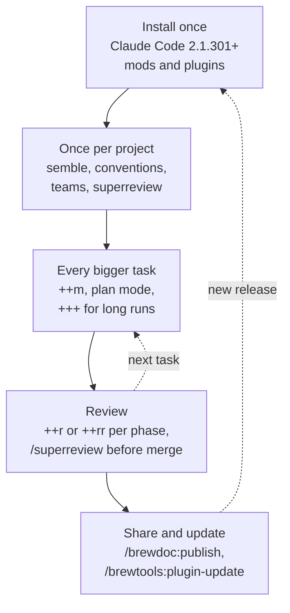

# claude-brewcode

[](https://code.claude.com)
[](https://doc-claude.brewcode.app/mods/overview/)
[](APPROACHES.md)
[](https://github.com/kochetkov-ma/claude-brewcode/releases/latest)
[](https://doc-claude.brewcode.app/getting-started/)
[](https://github.com/kochetkov-ma/claude-brewcode/stargazers)

**Claude Code mods:** type `++r` and get a whole review block; read it before you send, add your own with `/placeholders`. Plan mode raises effort to `xhigh`. [See the mods](#claude-code-mods)

**Claude Code plugin suite.** Keeps big tasks on track: bounded units, a six-field brief per spawn, the plan re-anchored after a compaction. 4 plugins, 27 skills, 9 agents. [**Full documentation**](https://doc-claude.brewcode.app/getting-started/) | [**Approaches**](APPROACHES.md) | [**Update**](UPDATE.md)

> **Security:** code is scanned on every commit ([Gitleaks](https://github.com/kochetkov-ma/claude-brewcode/actions/workflows/gitleaks.yml), [CodeQL](https://github.com/kochetkov-ma/claude-brewcode/actions/workflows/codeql.yml), [Semgrep](https://github.com/kochetkov-ma/claude-brewcode/actions/workflows/semgrep.yml)); no personal data is collected or transmitted.

## Install in 30 seconds

❗ **Update Claude Code first:** mods need 2.1.301+. Run `claude update`, restart, then paste this prompt:

```
Run in order, show full output; stop if `claude --version` < 2.1.301; end with `/reload-plugins`:
1. claude plugin marketplace add https://github.com/kochetkov-ma/claude-brewcode
2. claude plugin install brewmod-placeholders@claude-brewcode
3. claude plugin install brewmod-plan-effort@claude-brewcode
4. claude plugin install brewcode@claude-brewcode && claude plugin install brewdoc@claude-brewcode
5. claude plugin install brewtools@claude-brewcode && claude plugin install brewui@claude-brewcode
```

<details>
<summary>Already installed? Update</summary>

Short steps for you and your LLM, including what to try after the update: [UPDATE.md](UPDATE.md). Or paste this prompt:

```
Run in order, show full output; stop if `claude --version` < 2.1.301; end with `/reload-plugins`:
1. claude plugin marketplace update claude-brewcode
2. claude plugin update brewmod-placeholders@claude-brewcode
3. claude plugin update brewmod-plan-effort@claude-brewcode
4. claude plugin update brewcode@claude-brewcode && claude plugin update brewdoc@claude-brewcode
5. claude plugin update brewtools@claude-brewcode && claude plugin update brewui@claude-brewcode
```

</details>

## Claude Code mods

> Tiny add-ons, one feature each, one command to install. [brewcode.app/mods](https://brewcode.app/mods/) | [Docs](https://doc-claude.brewcode.app/mods/overview/)

<p align="center">
  <a id="mods-demo"></a>
</p>

❗ **Update Claude Code first:** mods need 2.1.301+ (`claude --version`; `claude update`, then restart Claude Code) and `node` on the `PATH`.

| Mod | Type this, get that | Install |
|-----|---------------------|---------|
| [brewmod-placeholders](brewmod-placeholders/README.md) | `++r` in a prompt: a whole review block. `/placeholders <what you want>`: Claude drafts your own | `claude plugin install brewmod-placeholders@claude-brewcode` |
| [brewmod-plan-effort](brewmod-plan-effort/README.md) | Enter plan mode: effort goes to `xhigh` while Claude plans. `/plan-effort max` sets the level | `claude plugin install brewmod-plan-effort@claude-brewcode` |

First time: `claude plugin marketplace add https://github.com/kochetkov-ma/claude-brewcode`, then `/reload-plugins` after installing.

Team/Enterprise organizations, the brewtools 6.7.x double injection and legacy codeword overrides are covered in the [mods overview](https://doc-claude.brewcode.app/mods/overview/).

## Top 5 features

### ⚡ 1. Prompt placeholders: the headline feature

Type `++r` and Claude receives a whole review-discipline block. A band above the prompt shows exactly the text it will get before you press Enter. Your own placeholders take one command: `/placeholders add ...`.

<p align="center">
  <a id="placeholders-demo"></a>
</p>

| You do | What happens |
|--------|--------------|
| Type `++` | Typeahead lists the names; `Tab` inserts one |
| Put the caret on `++r` | The band shows what Claude receives (up to 15 rows, the plan-mode addition marked) |
| Press Enter | Your prompt is sent as typed; the block goes along as hidden context, absent from the transcript |
| `++r?` alone, Enter twice, or `/placeholders show ++r` | Prints the whole text locally, no Claude turn |
| `/placeholders add ++ship: run the tests; in plan mode also list the release steps` | Claude drafts it, asks once, saves `ship.md` and `ship.plan.md` |
| `++/` in a message | The message is sent exactly as typed, no block |

Built in: `++m` (manager mode: delegate, never code), `++a` (architecture first), `++r` (two-phase review: review, reproduce, fix confirmed findings only), `++rr` (anti-regression review) and `+++` (an anti-drift cron for the current task).

Your files are `<name>.md` in `~/.claude/placeholders/` (global) or `.claude/placeholders/` (project, wins). A `<name>.plan.md` adds text in plan mode only. [Docs](https://doc-claude.brewcode.app/mods/placeholders/) | [brewmod-placeholders](brewmod-placeholders/README.md)

### 2. Skills and agents built with their own tooling

We create our skills and agents with the same commands you get:

| Command | Modes | Spawns |
|---------|-------|--------|
| [`/brewcode:skills`](https://doc-claude.brewcode.app/brewcode/skills/skills/) | `status`, `list`, `create`, `improve`, `review`, `sync` | `skill-creator` |
| [`/brewcode:agents`](https://doc-claude.brewcode.app/brewcode/skills/agents/) | `status`, `list`, `create`, `improve`, `review`, `sync` | `agent-creator` |

`sync` re-verifies each skill or agent against the code and cuts before it adds. `hook-creator` and `mod-creator` do the same job for hooks and Claude Code mods ([agents](https://doc-claude.brewcode.app/brewcode/agents/)).

### 3. Domain teams of subagents

[`/brewcode:teams-setup`](https://doc-claude.brewcode.app/brewcode/skills/teams-setup/) reads your project and builds a team of domain agents under `.claude/teams/<name>/` and `.claude/agents/`. Each agent profile has six ordered headings (Mission, Owned surfaces, Exclusions, Must-load references, Unique invariants, Unique verification). The roster gets one review-only `intent-guard` that checks what was asked against what was delivered.

```
/brewcode:teams-setup install a team for the payments module
```

Modes: `status | install | upgrade | enable | disable | uninstall | purge`. `disable` parks the roster; nothing is deleted.

### 4. Docs that stay current

[`/brewdoc:docsync-setup`](https://doc-claude.brewcode.app/brewdoc/skills/docsync-setup/) installs three project-local hooks: `docsync-track` logs every `.md` edit, `docsync-watch` logs reads, `docsync-gate` runs when Claude finishes a turn. For a doc edited in the session whose `last_updated` is missing or more than `threshold_days` behind the file, the gate blocks once and tells Claude to sync it. `sync` syncs the stale docs on demand.

[`/brewdoc:memory-sync-setup`](https://doc-claude.brewcode.app/brewdoc/skills/memory-sync-setup/) generates a project-local `/memory-sync` skill. It syncs everything Claude loads on its own (CLAUDE.md at any depth, rules, agents, skills, memory) against the code, without growing the files.

### 5. Publish to  [brewpage.app](https://brewpage.app)

[`/brewdoc:publish`](https://doc-claude.brewcode.app/brewdoc/skills/publish/) shares text, Markdown, JSON, a file, a folder or a ZIP site as a public link. Your content lives at your own URL, not in a Claude artifact. No sign-up; pages expire after their TTL (default 15 days). Claude may run it mid-task when you ask it to share something.

```
/brewdoc:publish report.pdf --ttl 1
/brewdoc:publish docs/v1/ --entry hub.html
```

A private slug is unlisted, not locked: anyone with the link can open the page unless you set a password.

### More

| Command | What you get |
|---------|--------------|
| [`/brewcode:superreview-setup`](https://doc-claude.brewcode.app/brewcode/skills/superreview-setup/) | A project-tailored deep-review skill: intent pass and mechanical gates, plus expert fan-out and adversarial validation at extended depth |
| [`/brewcode:semble-setup`](https://doc-claude.brewcode.app/brewcode/skills/semble-setup/) | A pinned `semble_code` MCP: semantic code search by intent |
| [`/brewcode:convention-setup`](https://doc-claude.brewcode.app/brewcode/skills/convention-setup/), [`/brewcode:rules`](https://doc-claude.brewcode.app/brewcode/skills/rules/) | Conventions behind a reversible loading rule (`.claude/rules/convention.md`); session learnings turned into project rules |
| [`/brewtools:manager-setup`](https://doc-claude.brewcode.app/brewtools/skills/manager-setup/) | Opt-in hard wall: a PreToolUse guard denies main-session edits and mutating shell commands, so the main agent delegates; subagents stay free |
| Subagent guards: [`agent-deadline-setup`](https://doc-claude.brewcode.app/brewtools/skills/agent-deadline-setup/), [`agent-return-setup`](https://doc-claude.brewcode.app/brewtools/skills/agent-return-setup/), [`agent-router-setup`](https://doc-claude.brewcode.app/brewtools/skills/agent-router-setup/) | A wall-clock budget per subagent (warning at 80%), a size budget on its final report, and a router that denies a generic spawn when a project expert owns the task (experimental) |
| [`/brewtools:task-board-setup`](https://doc-claude.brewcode.app/brewtools/skills/task-board-setup/) | A file-based task board for any repo with a derived task graph and session anti-drift timers |
| [compact-recall](https://doc-claude.brewcode.app/brewcode/hooks/) (hook, automatic) | After a compaction, re-injects the plan or intent and the task graph |
| [brewmod-plan-effort](https://doc-claude.brewcode.app/mods/plan-effort/) | Plan mode raises effort to `xhigh`; `/plan-effort max` sets the level; your session effort is untouched elsewhere |
| [`/brewtools:secrets-scan`](https://doc-claude.brewcode.app/brewtools/skills/secrets-scan/) | Scans git-tracked files for leaked secrets; `--fix` walks through remediation |
| [`/brewtools:text-optimize`](https://doc-claude.brewcode.app/brewtools/skills/text-optimize/), [`/brewtools:text-human`](https://doc-claude.brewcode.app/brewtools/skills/text-human/) | Cut tokens from prompts and docs in place (`-l`, `-s`, `-d`, `-x`); strip AI artifacts from code, docs and commits |

Also shipped: `/brewtools:ssh`, `/brewtools:deploy`, `/brewtools:provider-switch`, `/brewtools:context-slim`, `/brewcode:e2e`, `/brewdoc:md-to-pdf`. Full list: [Skills Reference](#skills-reference).

## Recommended flow

How the pieces fit, in the order they are used. Full page: [doc-claude.brewcode.app/recommended-flow](https://doc-claude.brewcode.app/recommended-flow/).

1. **Install once.** ❗ Claude Code 2.1.301+ first (`claude --version`; below that `claude update`, then restart Claude Code), then the install prompt above or [UPDATE.md](UPDATE.md).
2. **Once per project.** `/brewcode:semble-setup install`, `/brewcode:convention-setup install`, `/brewcode:teams-setup install`, `/brewcode:superreview-setup install`; docs-heavy repos also `/brewdoc:docsync-setup install`. Check with `/brewcode:setup-status`.
3. **Every bigger task.** Start with `++m` (manager: task graph and delegation); design in plan mode with `++m` (plan-effort raises effort to `xhigh`); long runs add `+++` (anti-drift cron).
4. **Review.** `++r` or `++rr` after each phase, the generated `/superreview` before merge.
5. **Share and stay current.** `/brewdoc:publish` returns a link; update with the release prompt or `/brewtools:plugin-update`.



## Plugin Suite

| Plugin | Purpose | Skills |
|--------|---------|--------|
| [brewcode](brewcode/README.md) | Authoring toolkit: skill, agent and rule creation and sync, semantic search (semble), conventions, E2E tests, generated review and team skills | 9 |
| [brewdoc](brewdoc/README.md) | Documentation tools: docsync, memory-sync generation, PDF conversion, publishing | 5 |
| [brewtools](brewtools/README.md) | Text optimization, secrets scanning, SSH and deploy, manager hard wall, subagent guards, task board, context slimming, plugin updates, alternative providers | 13 |
| [brewui](brewui/README.md) | UI/visual/creative tools (placeholder, currently empty) | 0 |

## Installation

Install with the prompts above or run `claude plugin install <plugin>@claude-brewcode` per plugin. Update with `/brewtools:plugin-update`. Run from source:

```bash
claude --plugin-dir ./brewcode --plugin-dir ./brewdoc --plugin-dir ./brewtools --plugin-dir ./brewui
```

| Component | Version | Purpose |
|-----------|---------|---------|
| Claude Code CLI | 2.1.296 reference for the plugins; mods 2.1.301+ | Plugin runtime |
| Node.js | 20+ | Hook runtime |
| macOS | 13+ | Supported OS (Linux and Windows planned) |

## Quick Start

```bash
/brewcode:setup-status       # Inspect setup state and the recommended order
/brewcode:convention-setup   # Establish coding and testing patterns first
/brewcode:teams-setup        # Create agents that use those conventions
/brewcode:superreview-setup  # Generate a project-tailored deep-review skill
```

Commands for every plugin are in its README: [brewcode](brewcode/README.md), [brewdoc](brewdoc/README.md), [brewtools](brewtools/README.md).

## How It Works

```
  accepted task --> /task-spec --> research + Q&A --> spec + design
        │
        v
  project agents from .claude/agents/ --> bounded units, fanned out in ONE message
        │
        v
  /brewcode:superreview-setup --> project-tailored deep-review skill

  after a compaction: compact-recall re-injects the plan or intent and the task graph
```

One subagent = one bounded unit (one deliverable, ~5 files, ~10 steps); bigger work is split into N tasks spawned in one message. Every spawn carries six fields: GOAL, ROLE, SCOPE, CONTEXT, CONSUMER, DONE -- see the [delegation contract](https://doc-claude.brewcode.app/brewcode/skills/#delegation).

## Skills Reference

27 skills: [brewcode](https://doc-claude.brewcode.app/brewcode/skills/) (9: authoring, semble search, conventions, E2E, review and team generators), [brewdoc](https://doc-claude.brewcode.app/brewdoc/skills/) (5: docsync, memory-sync, PDF, publish), [brewtools](https://doc-claude.brewcode.app/brewtools/skills/) (13: text, secrets, SSH, deploy, guards, task board), brewui (0).

> **`-setup` suffix:** 11 skills install a mechanism you use afterwards; all share the modes `status | install | upgrade | enable | disable | uninstall | purge`, and defaults are skill-specific (semble, manager, agent-deadline, agent-return, agent-router default to `status`).
>
> **24 of 27 skills are user-invoked only** (`disable-model-invocation: true`): you type `/plugin:skill`. Exceptions Claude may run mid-task: `/brewdoc:publish`, `/brewtools:text-optimize`, `/brewtools:text-human`.

### Portable skills (standalone)

Self-contained `SKILL.md` folders that ship outside the four plugins -- drop them into any compatible agent runtime. Both publish content to [brewpage.app](https://brewpage.app) (text, markdown, files, multi-file sites) and return a shareable URL.

| Skill | Runtime | Path |
|-------|---------|------|
| `brewpage-publish` | Claude Code | [`skills/brewpage-publish`](skills/brewpage-publish/) |
| `brewpage-publish` | OpenClaw / AgentSkills | [`openclaw/brewpage-publish`](openclaw/brewpage-publish/) |

## Agents (9 total)

| Agent | Plugin | Model | Purpose |
|-------|--------|-------|---------|
| skill-creator | brewcode | inherit | Create and improve Claude Code skills |
| agent-creator | brewcode | inherit | Create and improve Claude Code agents |
| hook-creator | brewcode | inherit | Create and debug Claude Code hooks |
| bash-expert | brewcode | inherit | Create professional shell scripts |
| mod-creator | brewcode | inherit | Create, test and ship Claude Code mods |
| bc-rules-organizer | brewcode | haiku | Internal: spawned by /brewcode:rules and /brewcode:convention-setup |
| text-optimizer | brewtools | sonnet | Optimize text and docs for LLM efficiency |
| ssh-admin | brewtools | inherit | Linux server administration via SSH |
| deploy-admin | brewtools | inherit | GitHub Actions deployment and CI/CD |

Every shipped agent stops and returns a split proposal when a task exceeds one bounded unit: [scope guard](https://doc-claude.brewcode.app/brewcode/agents/#scope-guard).

## Documentation

| Resource | Link |
|----------|------|
| Full documentation, quickstart | [doc-claude.brewcode.app](https://doc-claude.brewcode.app/getting-started/) / [Quickstart](https://doc-claude.brewcode.app/quickstart/) |
| Plugin overviews | [Brewcode](https://doc-claude.brewcode.app/brewcode/overview/), [Brewdoc](https://doc-claude.brewcode.app/brewdoc/overview/), [Brewtools](https://doc-claude.brewcode.app/brewtools/overview/), [Brewui](https://doc-claude.brewcode.app/brewui/overview/) |
| Mods overview | [Mods](https://doc-claude.brewcode.app/mods/overview/) |
| Release Notes | [RELEASE-NOTES.md](RELEASE-NOTES.md) |
| Brewcode site | [brewcode.app](https://brewcode.app) |
| brewdoc CLI -- standalone document-to-Markdown tool on PyPI, a separate product from the brewdoc plugin | [pypi.org/project/brewdoc](https://pypi.org/project/brewdoc/) |

## Development

```bash
claude --plugin-dir ./brewcode --debug   # Debug mode
[CLAUDE_CONFIG_DIR=<profile dir>] bash .claude/scripts/update-plugin.sh [plugin|all] [--dry-run]   # Update plugins; --dry-run changes nothing
bash .claude/scripts/bump-version.sh X.Y.Z      # Bump version everywhere
```

## License

MIT -- see [LICENSE](LICENSE)
