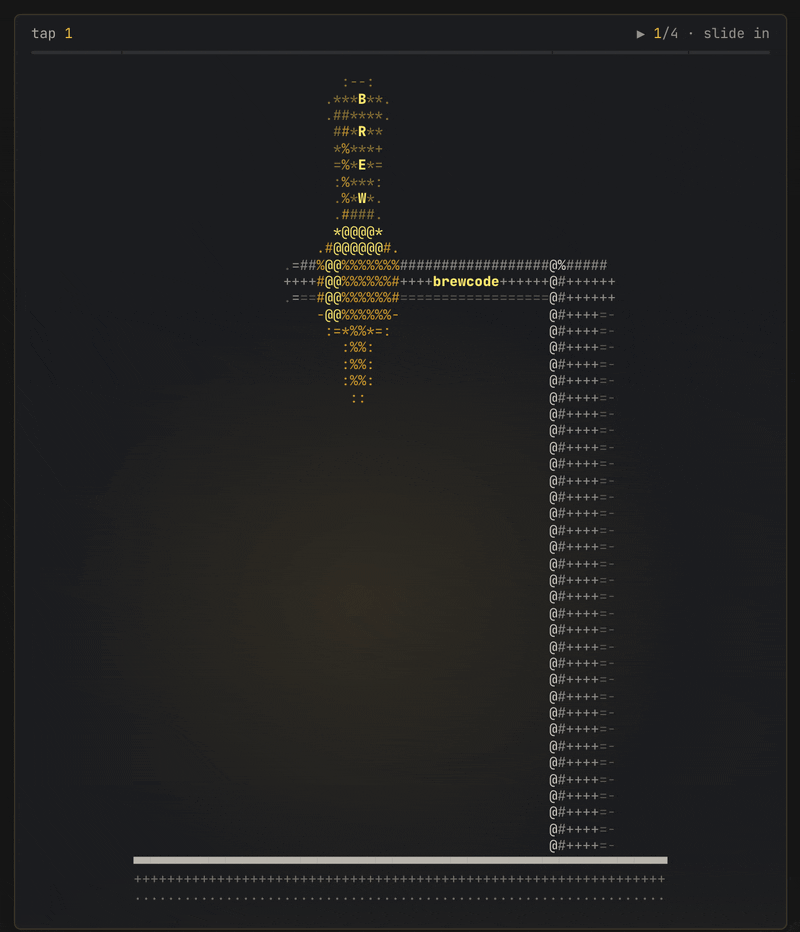

# claude-brewcode

[](https://code.claude.com)
[](https://github.com/kochetkov-ma/claude-brewcode/releases/latest)
[](https://doc-claude.brewcode.app/getting-started/)

**Claude Code plugin suite.** A regular session hands a big task to one agent and loses sight of it. Brewcode splits work into bounded units, gives every spawn a six-field brief, and re-anchors the plan and task graph after a compaction. Four plugins, 27 skills, 9 agents, plus two optional [mods](#claude-code-mods).

[**Full documentation**](https://doc-claude.brewcode.app/getting-started/) | [**Approaches**](APPROACHES.md) -- every hook, agent and injection the suite installs.

> **Security:** code is scanned on every commit ([Gitleaks](https://github.com/kochetkov-ma/claude-brewcode/actions/workflows/gitleaks.yml), [CodeQL](https://github.com/kochetkov-ma/claude-brewcode/actions/workflows/codeql.yml), [Semgrep](https://github.com/kochetkov-ma/claude-brewcode/actions/workflows/semgrep.yml)); no personal data is collected or transmitted.

## Install in 30 seconds

Paste this prompt into any Claude Code session -- Claude will run the full install for you:

```
Execute these commands in this Claude Code session, one by one, show full output for each, do not skip any, do not summarize:

1. claude plugin marketplace add https://github.com/kochetkov-ma/claude-brewcode
2. claude plugin install brewcode@claude-brewcode
3. claude plugin install brewdoc@claude-brewcode
4. claude plugin install brewtools@claude-brewcode
5. claude plugin install brewui@claude-brewcode

After all commands succeed, run `/reload-plugins`. If `/reload-plugins` is unavailable, tell me to type `exit` and run `claude` again. Run the commands now.
```

Already installed? Update with this prompt:

```
Execute these commands in this Claude Code session, one by one, show full output for each, do not skip any, do not summarize:

1. claude plugin marketplace update claude-brewcode
2. claude plugin update brewcode@claude-brewcode
3. claude plugin update brewdoc@claude-brewcode
4. claude plugin update brewtools@claude-brewcode
5. claude plugin update brewui@claude-brewcode

After all commands succeed, run `/reload-plugins`. If `/reload-plugins` is unavailable, tell me to type `exit` and run `claude` again. Run the commands now.
```

> Mods are optional: see [Claude Code mods](#claude-code-mods) below. After install or update, run `/reload-plugins` (or `exit` + `claude`). Requirements and local install: [Installation](#installation).

## Claude Code mods

> Tiny add-ons that change how Claude Code behaves. One feature each, one command to install, no suite needed. [brewcode.app/mods](https://brewcode.app/mods/) | [Docs](https://doc-claude.brewcode.app/mods/overview/)

[](https://github.com/kochetkov-ma/claude-brewcode/stargazers)

<p align="center">
  
</p>

| Mod | Type this, get that | Install |
|-----|---------------------|---------|
| [brewmod-plan-effort](brewmod-plan-effort/README.md) | Enter plan mode: effort goes to `xhigh` while Claude plans. `/plan-effort max` sets the level | `claude plugin install brewmod-plan-effort@claude-brewcode` |
| [brewmod-placeholders](brewmod-placeholders/README.md) | `++r` in a prompt: a whole review block. `/placeholders <what you want>`: Claude drafts your own | `claude plugin install brewmod-placeholders@claude-brewcode` |

First time: `claude plugin marketplace add https://github.com/kochetkov-ma/claude-brewcode`, then `/reload-plugins` after installing. Needs Claude Code 2.1.287+ (placeholders 2.1.292+) and `node` on the `PATH`; the `/plan-effort` and `/placeholders` commands are verified on 2.1.300.

Team/Enterprise organizations, the brewtools 6.7.x double injection and legacy codeword overrides: [mods overview](https://doc-claude.brewcode.app/mods/overview/).


## Plugin Suite

| Plugin | Purpose | Skills |
|--------|---------|--------|
| [brewcode](brewcode/README.md) | Authoring toolkit: skill, agent and rule creation and sync, semantic search (semble), conventions, E2E tests, generated review and team skills | 9 |
| [brewdoc](brewdoc/README.md) | Documentation tools: docsync, memory-sync generation, PDF conversion, publishing | 5 |
| [brewtools](brewtools/README.md) | Text optimization, secrets scanning, SSH and deploy, manager hard wall, subagent guards, task board, context slimming, plugin updates, alternative providers | 13 |
| [brewui](brewui/README.md) | UI/visual/creative tools (placeholder, currently empty) | 0 |

## Installation

Install with the prompts above or run `claude plugin install <plugin>@claude-brewcode` per plugin. Update with `/brewtools:plugin-update`. Run from source:

```bash
claude --plugin-dir ./brewcode --plugin-dir ./brewdoc --plugin-dir ./brewtools --plugin-dir ./brewui
```

| Component | Version | Purpose |
|-----------|---------|---------|
| Claude Code CLI | latest | Plugin runtime |
| Node.js | 20+ | Hook runtime |
| macOS | 13+ | Supported OS (Linux and Windows planned) |

## Quick Start

```bash
/brewcode:setup-status       # Inspect setup state and the recommended order
/brewcode:convention-setup   # Establish coding and testing patterns first
/brewcode:teams-setup        # Create agents that use those conventions
/brewcode:superreview-setup  # Generate a project-tailored deep-review skill
```

Commands for every plugin are in its README: [brewcode](brewcode/README.md), [brewdoc](brewdoc/README.md), [brewtools](brewtools/README.md).

## How It Works

```
  accepted task --> /task-spec --> research + Q&A --> spec + design
        │
        v
  project agents from .claude/agents/ --> bounded units, fanned out in ONE message
        │
        v
  /brewcode:superreview-setup --> project-tailored deep-review skill

  after a compaction: compact-recall re-injects the plan or intent and the task graph
```

One subagent = one bounded unit (one deliverable, ~5 files, ~10 steps); bigger work is split into N tasks spawned in one message. Every spawn carries six fields: GOAL, ROLE, SCOPE, CONTEXT, CONSUMER, DONE -- see the [delegation contract](https://doc-claude.brewcode.app/brewcode/skills/#delegation).

## Skills Reference

27 skills: [brewcode](https://doc-claude.brewcode.app/brewcode/skills/) (9: authoring, semble search, conventions, E2E, review and team generators), [brewdoc](https://doc-claude.brewcode.app/brewdoc/skills/) (5: docsync, memory-sync, PDF, publish), [brewtools](https://doc-claude.brewcode.app/brewtools/skills/) (13: text, secrets, SSH, deploy, guards, task board), brewui (0).

> **`-setup` suffix:** 11 skills install a mechanism you use afterwards; all share the modes `status | install | upgrade | enable | disable | uninstall | purge`, and defaults are skill-specific (semble, manager, agent-deadline, agent-return, agent-router default to `status`).
>
> **24 of 27 skills are user-invoked only** (`disable-model-invocation: true`): you type `/plugin:skill`. Exceptions Claude may run mid-task: `/brewdoc:publish`, `/brewtools:text-optimize`, `/brewtools:text-human`.

### Portable skills (standalone)

Self-contained `SKILL.md` folders that ship outside the four plugins -- drop them into any compatible agent runtime. Both publish content to [brewpage.app](https://brewpage.app) (text, markdown, files, multi-file sites) and return a shareable URL.

| Skill | Runtime | Path |
|-------|---------|------|
| `brewpage-publish` | Claude Code | [`skills/brewpage-publish`](skills/brewpage-publish/) |
| `brewpage-publish` | OpenClaw / AgentSkills | [`openclaw/brewpage-publish`](openclaw/brewpage-publish/) |

## Agents (9 total)

| Agent | Plugin | Model | Purpose |
|-------|--------|-------|---------|
| skill-creator | brewcode | inherit | Create and improve Claude Code skills |
| agent-creator | brewcode | inherit | Create and improve Claude Code agents |
| hook-creator | brewcode | inherit | Create and debug Claude Code hooks |
| bash-expert | brewcode | inherit | Create professional shell scripts |
| mod-creator | brewcode | inherit | Create, test and ship Claude Code mods |
| bc-rules-organizer | brewcode | haiku | Internal: spawned by /brewcode:rules and /brewcode:convention-setup |
| text-optimizer | brewtools | sonnet | Optimize text and docs for LLM efficiency |
| ssh-admin | brewtools | inherit | Linux server administration via SSH |
| deploy-admin | brewtools | inherit | GitHub Actions deployment and CI/CD |

Every shipped agent stops and returns a split proposal when a task exceeds one bounded unit: [scope guard](https://doc-claude.brewcode.app/brewcode/agents/#scope-guard).

## Documentation

| Resource | Link |
|----------|------|
| Full documentation, quickstart | [doc-claude.brewcode.app](https://doc-claude.brewcode.app/getting-started/) / [Quickstart](https://doc-claude.brewcode.app/quickstart/) |
| Plugin overviews | [Brewcode](https://doc-claude.brewcode.app/brewcode/overview/), [Brewdoc](https://doc-claude.brewcode.app/brewdoc/overview/), [Brewtools](https://doc-claude.brewcode.app/brewtools/overview/), [Brewui](https://doc-claude.brewcode.app/brewui/overview/) |
| Mods overview | [Mods](https://doc-claude.brewcode.app/mods/overview/) |
| Release Notes | [RELEASE-NOTES.md](RELEASE-NOTES.md) |
| Brewcode site | [brewcode.app](https://brewcode.app) |
| brewdoc CLI -- standalone document-to-Markdown tool on PyPI, a separate product from the brewdoc plugin | [pypi.org/project/brewdoc](https://pypi.org/project/brewdoc/) |

## Development

```bash
claude --plugin-dir ./brewcode --debug   # Debug mode
[CLAUDE_CONFIG_DIR=<profile dir>] bash .claude/scripts/update-plugin.sh [plugin|all] [--dry-run]   # Update plugins; --dry-run changes nothing
bash .claude/scripts/bump-version.sh X.Y.Z      # Bump version everywhere
```

## License

MIT -- see [LICENSE](LICENSE)
