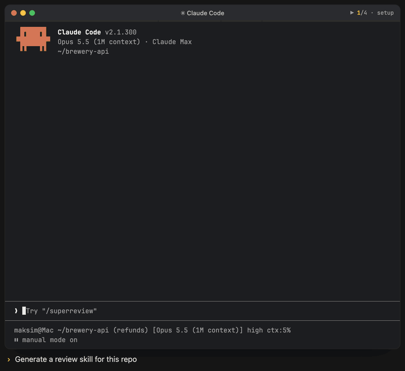

# Brewcode

<p align="center"><br><sub>Illustrative animation: generate the skill with superreview-setup → run /superreview on a scope → QUICK review → read-only report.</sub></p>

> Claude Code authoring toolkit -- skill, agent and rule creation and sync, semantic code search, project conventions, E2E tests, generated review and team skills, setup dashboard with one-step upgrades, post-compact plan re-anchor.

| Field | Value |
|-------|-------|
| Version | 6.11.1 |
| Skills | 9 |
| Agents | 7 |
| Hooks | 2 |
| Model | opus |

## Install

Paste this into a Claude Code session:

```
Execute these commands in this session, one by one, show full output for each, do not skip any:

1. claude plugin marketplace add https://github.com/kochetkov-ma/claude-brewcode
2. claude plugin install brewcode@claude-brewcode

After install, run `/reload-plugins` (or `exit` + `claude`).
```

<details>
<summary>Or install the whole suite (plugins and mods)</summary>

❗ **Update Claude Code first:** mods need Claude Code 2.1.301 or newer. Check with `claude --version`; below that, run `claude update`, then restart Claude Code (type `exit`, then run `claude`).

```
First run `claude --version`. The mods need Claude Code 2.1.301 or newer. If it is lower, stop and tell me to run `claude update`, restart Claude Code (type `exit`, then run `claude`) and paste this prompt again.

Execute these commands in this Claude Code session, one by one, show full output for each, do not skip any, do not summarize:

1. claude plugin marketplace add https://github.com/kochetkov-ma/claude-brewcode
2. claude plugin install brewmod-placeholders@claude-brewcode
3. claude plugin install brewmod-plan-effort@claude-brewcode
4. claude plugin install brewmod-reminders@claude-brewcode
5. claude plugin install brewcode@claude-brewcode
6. claude plugin install brewdoc@claude-brewcode
7. claude plugin install brewtools@claude-brewcode
8. claude plugin install brewui@claude-brewcode

After all commands succeed, run `/reload-plugins`. If `/reload-plugins` is unavailable, tell me to type `exit` and run `claude` again. Run the commands now.
```
</details>

Update anytime with `/brewtools:plugin-update`, or by hand:

```bash
claude plugin marketplace update claude-brewcode
claude plugin update brewcode@claude-brewcode
```

After an update, run `/reload-plugins`, then `/brewcode:setup-status upgrade` in each project to bring stale setups current. The `/brewtools:plugin-update` report lists the same next steps.

Dev mode (no install): `claude --plugin-dir ./brewcode`

## Claude Code mods

Brewcode mods from the same marketplace: [overview](https://doc-claude.brewcode.app/mods/overview/), [placeholders](https://doc-claude.brewcode.app/mods/placeholders/), [plan-effort](https://doc-claude.brewcode.app/mods/plan-effort/), [reminders](https://doc-claude.brewcode.app/mods/reminders/) (durable reminders that survive sessions, `/remind`).

❗ **Update Claude Code first:** mods need Claude Code 2.1.301 or newer. Check with `claude --version`; below that, run `claude update`, then restart Claude Code (type `exit`, then run `claude`).

```bash
claude plugin install brewmod-placeholders@claude-brewcode
claude plugin install brewmod-plan-effort@claude-brewcode
claude plugin install brewmod-reminders@claude-brewcode
```

`claude plugin install` takes one name per call. Run `/reload-plugins` afterwards.

## Overview

After a Claude Code compaction, the `compact-recall` hook re-anchors the plan, intent and task graph, so the session continues from recorded state. Skills cover semantic code search, multi-agent review, conventions, e2e, project rules and meta-tooling for skills, agents and teams. The shipped agents are specialists only; `/brewcode:teams-setup` generates the implementation, testing and review roles per project.

## Quick Start

```bash
/brewcode:setup-status        # What is installed in this project, and what to run next
/brewcode:setup-status upgrade  # Upgrade stale setups; any question is declined and listed as pending
/brewcode:convention-setup    # Establish project patterns before teams and review setup
/brewcode:teams-setup         # Create agents that follow those conventions
/brewcode:superreview-setup   # Generate a project-tailored deep-review skill
```

## Skills

A `-setup` suffix marks a skill that installs a mechanism you use afterwards; bare names (`agents`, `rules`, `skills`, `e2e`) are recurring tools. Every `-setup` skill takes `status | install | upgrade | enable | disable | uninstall | purge`, in that order; extras come after (`semble-setup`: `reindex | optimize | resume`; `teams-setup`: `[name]`). Bare call: `status` when installed, else `install`; `semble-setup` and the four brewtools guard setups (manager, agent-deadline, agent-return, agent-router) always `status`, `convention-setup` `install`.

| Skill | Purpose |
|-------|---------|
| [`/brewcode:setup-status`](skills/setup-status/README.md) | Dashboard of 11 setups and 23 stamp carriers, with the next command (`report` \| `upgrade`). `upgrade` runs every stale setup whose fix is the setup's own `upgrade`, one `setup-upgrader` subagent per setup: quick ones on sonnet, long ones on the owner's model with their questions declined and reported as pending. `convention-setup` and rows that are modified, custom, parked or need `--force` stay with you |
| [`/brewcode:superreview-setup`](skills/superreview-setup/README.md) | Generate a project-tailored deep-review skill: `QUICK` (default) or `EXTENDED` |
| [`/brewcode:teams-setup`](skills/teams-setup/README.md) | Create, manage and track dynamic agent teams; one review-only `intent-guard` |
| [`/brewcode:semble-setup`](skills/semble-setup/README.md) | Pinned semble_code MCP, semble-first rule + hooks, agent migration |
| [`/brewcode:convention-setup`](skills/convention-setup/README.md) | Coding, testing and architecture conventions with reversible loading |
| [`/brewcode:rules`](skills/rules/README.md) | Rules management: status, create, improve, review |
| [`/brewcode:skills`](skills/skills/README.md) | Skill management: status, create, improve, sync, review |
| [`/brewcode:agents`](skills/agents/README.md) | Agent management: status, create, improve, sync, review |
| [`/brewcode:e2e`](skills/e2e/README.md) | E2E orchestration, BDD scenarios; modes `status \| install \| create \| update \| review \| rules` |

> **Run setups one at a time.** Installs and interview upgrades ask questions and fan out subagents; two in a session degrade each other. `/brewcode:setup-status` prints the command for each; the `setup-status` row above lists what `upgrade` runs for you. Run the rest yourself, one per session.

## Agents

| Agent | Model | Purpose |
|-------|-------|---------|
| [skill-creator](agents/skill-creator.md) | inherit | Creates and improves skills |
| [agent-creator](agents/agent-creator.md) | inherit | Creates and improves agents |
| [hook-creator](agents/hook-creator.md) | inherit | Creates and debugs hooks |
| [bash-expert](agents/bash-expert.md) | inherit | Creates sh/bash scripts for Mac/Linux |
| [mod-creator](agents/mod-creator.md) | inherit | Creates, tests and ships Claude Code mods |
| [bc-rules-organizer](agents/bc-rules-organizer.md) | haiku | Internal: spawned by /brewcode:rules and /brewcode:convention-setup |
| [setup-upgrader](agents/setup-upgrader.md) | inherit | Internal: spawned only by /brewcode:setup-status upgrade, one setup per spawn; runs that owner's `upgrade` with `--unattended`, every gate declined and left pending |

No generic agents ship: generate them with `/brewcode:teams-setup install`.

## Hooks

| Hook | Event | Purpose |
|------|-------|---------|
| session-start | SessionStart | Version check, plan symlink, `permission_mode` tag |
| compact-recall | SessionStart (matcher `compact`) | Re-anchors plan/intent and task graph from this session's transcript only |

## Documentation

Full docs: [doc-claude.brewcode.app/brewcode/overview](https://doc-claude.brewcode.app/brewcode/overview/)

| Resource | Link |
|----------|------|
| Skills, agents, hooks | [Skills](https://doc-claude.brewcode.app/brewcode/skills/) \| [Agents](https://doc-claude.brewcode.app/brewcode/agents/) \| [Hooks](https://doc-claude.brewcode.app/brewcode/hooks/) |
| Setup workflow | [Full Setup](https://doc-claude.brewcode.app/full-setup/) |
| Mods | [Mods overview](https://doc-claude.brewcode.app/mods/overview/) \| [placeholders](https://doc-claude.brewcode.app/mods/placeholders/) \| [plan-effort](https://doc-claude.brewcode.app/mods/plan-effort/) \| [reminders](https://doc-claude.brewcode.app/mods/reminders/) |
| Release Notes | [RELEASE-NOTES.md](../RELEASE-NOTES.md) |

Author: Maksim Kochetkov | License: MIT
