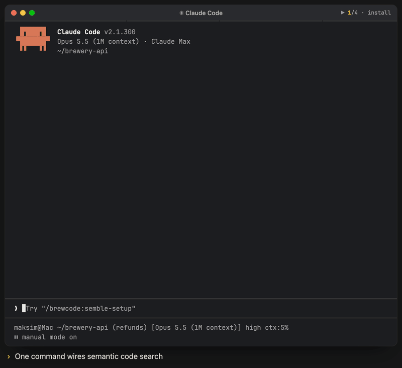

# Semble

<p align="center"><br><sub>Illustrative animation: install wires the server → resume warms the index → a behaviour question runs a semantic search → a status card closes. File names, scores and timings are invented.</sub></p>

Lifecycle skill for **`semble_code`**, a semantic repository-search MCP server ([semble](https://pypi.org/project/semble/), pinned to exact `semble[mcp]==0.6.2`) wired into any project: install, audit, configure, repair, upgrade, enable, disable, reindex, uninstall.

One command covers the whole lifecycle. It reports the current state **before** it changes anything; every mutation is delegated to a script.

## Install

```bash
claude plugin marketplace add https://github.com/kochetkov-ma/claude-brewcode
claude plugin install brewcode@claude-brewcode
```

Then run `/brewcode:semble-setup install` and, after the reload, `/brewcode:semble-setup resume`.

## Usage

```
/brewcode:semble-setup            # status (default, no args, read-only; a bare call never installs)
/brewcode:semble-setup install    # prereqs -> register MCP -> reload checkpoint
/brewcode:semble-setup resume     # after the reload: verify + wire guidance
```

Free text in Russian or English routes to one mode (`references/intent-routing.md`). The seven canonical modes every `-setup` skill shares, in order:

| Mode | Effect | Mutates |
|------|--------|---------|
| `status` | full report: prereqs, MCP, version check (registered vs pin vs upstream), cache, guidance, agents, coverage, state | no |
| `install` | install `uv` (and, if you accept, `coreutils`), register `semble_code` at user scope, **wire the rule, the CLAUDE.md block, the three hooks, the permissions and the agent frontmatter**, checkpoint for reload | yes |
| `upgrade` | re-check pin `0.6.2` and registration, re-sync rule, `.sembleignore`, hooks and settings; hand-edited files are skipped with a diff, `--force` backs up first | yes |
| `enable` | back on: verify, warm, `phase=ready` | yes |
| `disable` | `enabled=false` — hooks go silent, nothing is deleted | yes |
| `uninstall` | four flavours: `integration` / `mcp` / `cli` / `purge` | yes |
| `purge` | integration + MCP + CLI + this project's cache entry — typed confirmation required | yes |

Plus three extras specific to a search index:

| Mode | Effect | Mutates |
|------|--------|---------|
| `reindex` | stage and prove a replacement for this repo's `index-code-config-docs`, then swap only that variant | yes |
| `optimize` | read-only audit fan-out with concrete recommendations | no |
| `resume` | after the reload checkpoint: run the workflow-deferred pinned CLI smoke, then a self-repairing re-run of the rule + hooks + permissions + agent migration, then `phase=ready` | yes |

**Empty input is always `status`**: read-only, no questions, no mutation. This is the one setup skill that does not fall back to `install` when nothing is installed, because `install` reaches machine-level package management.

## What you get

Two MCP tools, once wired: `mcp__semble_code__search` (find code by intent) and `mcp__semble_code__find_related` (neighbors of a known location). Both require `repo` (absolute project root or `https://` git URL, never inferred) and accept optional `content=code|docs|config|all`. Intent -> semble; symbols -> LSP; literals, regexes, paths, counts -> `rg`.

## Documentation

Full docs, limits, troubleshooting and file reference: [semble-setup](https://doc-claude.brewcode.app/brewcode/skills/semble-setup/)

## License

MIT, see `LICENSE`.
