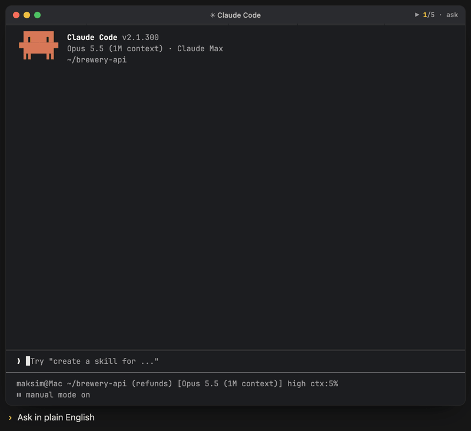

# Skills

<p align="center"><br><sub>Illustrative animation: ask in plain English → hand-off to skill-creator → run the new skill → summary card. Names and numbers come from an invented demo project.</sub></p>

Manages Claude Code skills across global, project and plugin scopes: check status, create from a free-form prompt, improve, review, or sync with the codebase. Operations are delegated to the `brewcode:skill-creator` agent. No keyword grammar.

## Install

```bash
claude plugin marketplace add https://github.com/kochetkov-ma/claude-brewcode
claude plugin install brewcode@claude-brewcode
```

## Usage

```text
/brewcode:skills
/brewcode:skills create a skill that scans for hardcoded secrets
/brewcode:skills sync session
```

No arguments = rich read-only `status`. A `PLAN — brewcode:skills` block prints before any work; write decisions are asked once. Ask for the menu explicitly to choose an action.

| Mode | How it activates | What it does |
|------|-----------------|--------------|
| `status` | Default for any "show me" intent | Inventory per scope, state and model, overlaps, health flags |
| `list` | Explicit only — "list" | Runs `list-skills.sh`, plain file listing |
| `create` | "create" / "new" / "scaffold" | skill-creator researches and generates a new SKILL.md + README.md |
| `improve` | "improve" / "refactor" / "fix", or a bare existing name/path | skill-creator rewrites the target SKILL.md with optimized content |
| `review` | "review" / "validate" | the project reviewer agent (else `general-purpose`) audits skill files, two-phase |
| `sync` | "sync", "memory sync", "bring in line with the code" | re-verifies SKILL.md and references against the code: delete first, never grow |

Batch flag (not a mode): a plural form, "all", or several names fan out to one spawn per item.

Create/improve questions (invocation type, testing depth, review type) are asked once up front. The generated `description:` is one line of at most about 100 tokens (~400 characters).

Sync scopes: `repo` (default), `session`, `commit` (default `HEAD`). Shared implementation with `/brewcode:agents sync`: `references/mode-sync.md`.

## Documentation

Full docs: [skills](https://doc-claude.brewcode.app/brewcode/skills/skills/)
