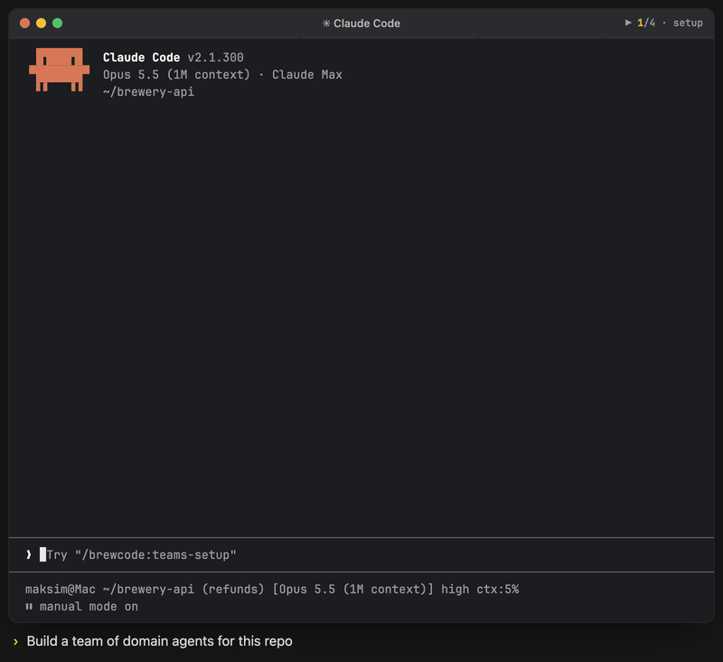

# Teams

<p align="center"><br><sub>Illustrative animation: install a team → describe a task → owning agents take it in parallel → status shows health per agent. Project and agent names are invented.</sub></p>

Create and manage a team of domain-specific agents. The skill analyzes your project, proposes 5-20 specialized agents, creates them with quorum review, and sets up performance tracking that drives later tuning. A new team also gets exactly one review-only `intent-guard`; an upgraded legacy team with none stays that way.

## Install

```bash
claude plugin marketplace add https://github.com/kochetkov-ma/claude-brewcode
claude plugin install brewcode@claude-brewcode
```

## Usage

```
/brewcode:teams-setup install my-project
```

Argument hint: `[prompt] [status|install|upgrade|enable|disable|uninstall|purge] [name] [--unattended]`

| Mode | Invocation | Description |
|------|-----------|-------------|
| Status | `/brewcode:teams-setup status <name>` | Read-only report: agent health, success rates, issues, insights |
| Install | `/brewcode:teams-setup install <name> [prompt]` | Analyze project, propose team, create agents + tracking framework |
| Upgrade | `/brewcode:teams-setup upgrade <name>` | Analyze performance, tune or replace underperformers |
| Enable | `/brewcode:teams-setup enable <name>` | Restore a disabled team: every parked `<agent>.md.disabled` is renamed back to `<agent>.md`; the `team.md` rows return to `active` and its header is restamped |
| Disable | `/brewcode:teams-setup disable <name>` | Park the team without deleting it: each `<agent>.md` becomes `<agent>.md.disabled`. In `team.md` only the parked rows' `Status` cells and the header change; `trace.jsonl` and the archive are untouched |
| Uninstall | `/brewcode:teams-setup uninstall <name>` | Archive old tracking data, remove inactive agents |
| Purge | `/brewcode:teams-setup purge <name>` | Total removal: every domain agent + `.claude/teams/<name>/` incl. the archive. Confirmed once, not recoverable |

No arguments: `status` of the first existing team, or `install` of a team named `default` when none exists. In a bare `mode [name]` pair the verb comes first, so `install enable` creates a team named `enable`; in a sentence the name comes from the text ("disable the payments team" names `payments`). `enable` and `disable` take effect for the NEXT session. Team names use ASCII letters, digits, `-` and `_`, with no leading dash.

`--unattended` (set by `/brewcode:setup-status upgrade`) lets only `upgrade` run, asks nothing and does the plumbing: migration, re-copied scripts, header restamp and verify. Tuning stays interactive.

`purge` keeps `.claude/agents/intent-guard.md` (shared with `/brewcode:superreview-setup`). Agents owned by another generator are never touched.

## Output

```
.claude/
  agents/<agent>.md          # domain agents, six ordered headings each
  teams/<name>/team.md       # roster; Intent guard: required|legacy-absent
  teams/<name>/trace.jsonl   # append-only log
  teams/<name>/trace-ops.sh  # project-local tracer
```

`intent_guard_policy=required|legacy-absent`: `required` means exactly one `intent-guard` row; `legacy-absent` means none, and `upgrade` never adds it.

## Documentation

Full docs, flow, intent-guard and tracing: [teams-setup](https://doc-claude.brewcode.app/brewcode/skills/teams-setup/). Foreign-agent rules: [Agents owned by another generator](https://doc-claude.brewcode.app/brewcode/skills/teams-setup/#agents-owned-by-another-generator).
