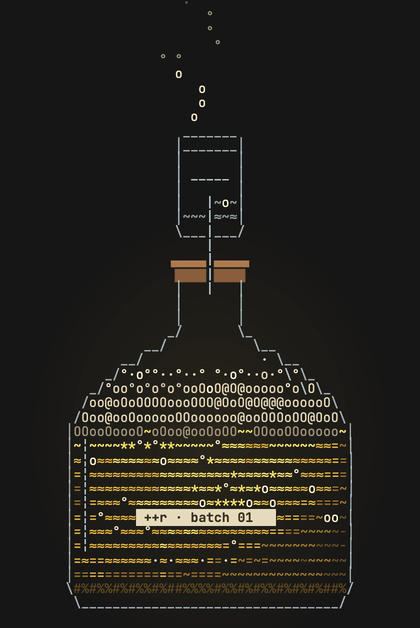
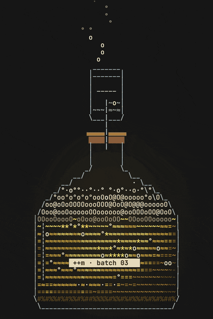

<!-- Stable deep link, shared outside the repo: #demo. Keep the id. -->
<p align="center">
  <a id="demo"></a>
</p>
<p align="center">
  <br><sub>Real Claude Code 2.1.301 screens, sped up where the title bar shows ⏩. <code>++</code> <code>↑</code> <code>⇥</code> insert a placeholder, the band shows what Claude receives, <code>⏎</code> sends; <code>⇧⇥</code> twice = plan mode; <code>++/</code> = send as typed.</sub>
</p>
<h1 align="center">Prompt placeholders</h1>
<p align="center">Prompt shortcuts for Claude Code: type <code>++r</code> to attach a saved instruction block, read its text before you send, add your own with <code>/placeholders</code>.</p>
<p align="center">
  <a href="https://github.com/kochetkov-ma/claude-brewcode/stargazers"></a>
  
  
  
</p>

> [!NOTE]
> **Looking for ++m, ++r or +++?** The codewords `++m`, `++a`, `++r`, `++rr` and `+++` come with this mod. Install it once and they work in every prompt, next to placeholders you write yourself: see [Install](#install), the [Quick start](#quick-start) and the [docs page](https://doc-claude.brewcode.app/mods/placeholders/).

## Install

> ❗ **Update Claude Code first:** the mods need Claude Code 2.1.301 or newer. Check with `claude --version`; if it is lower, run `claude update`, then restart Claude Code (exit, run `claude`).

```bash
claude plugin marketplace add https://github.com/kochetkov-ma/claude-brewcode && claude plugin install brewmod-placeholders@claude-brewcode
```
Then run `/reload-plugins`. Works on Team organizations.

<details>
<summary>Update, dev mode, requirements</summary>

Update: run `claude update` and restart Claude Code, then `claude plugin marketplace update claude-brewcode && claude plugin update brewmod-placeholders@claude-brewcode`. Dev mode, no install: `claude --plugin-dir ./brewmod-placeholders`. Needs Claude Code 2.1.301 or newer and `node` on the `PATH` (the bundled command hook runs as plain Node). Mods use the hooks module API, which is early access.

</details>

## Quick start
| Want | Do |
|---|---|
| Add a block | `++r check the diff`, then Enter. The block is sent as hidden context; your prompt stays as typed |
| Read a token's text while typing | Put the caret on it (arrows, Home, End). The band shows up to 15 rows of its text, cut row and plan note included; move the caret off to return to the compact band ([details](#read-the-full-text)) |
| Print the whole text | `/placeholders show ++r`, or `++r?` alone and Enter twice ([how](#read-the-full-text)). `/placeholders list` prints all. Full help: `/placeholders help`, or `/placeholders` plus a question in your own words |
| Make your own | `/placeholders add ++ship: …`. With no scope word the one dialog also asks `Where` (Global recommended, or Project); start with `global` or `project` to skip that question |

## What Claude receives
```text
you type      ++r check the diff
Claude reads  ++r check the diff                     <- your prompt, unchanged
            + hidden context (not shown in the transcript, not even with ctrl+o):
              User typed `++r` — Two-phase review discipline is active for this turn:
              [REVIEW DISCIPLINE: DOUBLE-CHECK]
              Every significant change: multi-agent review ... (11 lines in all)
```

| Token | Normal mode | Plan mode |
|---|---|---|
| `++m` | `Manager mode is active`: `[ROLE: MANAGER]`, delegate, never code (29 lines) | `Manager + Plan Mode is active`: the same text **+ `[ADDON: PLAN MODE]`**: stay read-only; the plan opens with the role and the full task graph (48 lines) |
| `++a` | `Architecture-first`: delegate the design to expert agents before implementing | same text: `++a` has no plan part |
| `++r` | `[REVIEW DISCIPLINE: DOUBLE-CHECK]`: review, reproduce, fix confirmed findings only (11 lines) | same text: `++r` has no plan part |
| `++rr` | `Anti-regression review`: regression, project standard and functional correctness axes | same text: `++rr` has no plan part |
| `+++` | `Anti-drift cron is active`: `[ADDON: ANTI-DRIFT CRON]`, asks Claude to create one unique session cron for the current task now (9 lines) | `plan the task anti-drift cron`: the same text **+ `[ADDON: ANTI-DRIFT CRON PLAN]`**: create no cron now, plan it as an execution step (13 lines) |
| `++rr` + `++r` | only `++rr` is sent (one review per message) | same |

Every placeholder is sent in every mode. A placeholder with a plan part sends that part as an addition in plan mode only. Line counts are lines of the sent text, header line included: the numbers the band uses.

<details><summary><code>++r</code> text as sent</summary>

```text
User typed `++r` — Two-phase review discipline is active for this turn:

[REVIEW DISCIPLINE: DOUBLE-CHECK]
Every significant change: multi-agent review (matching reviewer expert, else
general-purpose), simplification pass first.
1) Review - finding = defect with path:line + evidence (failing command/input).
2) Double-check - reproduce each finding.
3) Fix - confirmed findings only.
Big review -> split by area, never one long pass. Brief each: goal + area +
acceptance, what's covered (don't re-litigate), who consumes the verdict;
return verdict first, then findings.
```
</details>
<details><summary><code>++m</code> text as sent, normal and plan mode</summary>

```text
User typed `++m` — Manager mode is active for this turn:

[ROLE: MANAGER]

Manage; never code/build/test/hand-debug: the main context is for orchestration.

Protocol: 1) TaskList; graph exists -> reuse it, else TaskCreate the full graph
before any work. 2) addBlockedBy/addBlocks only for real data-handoffs, else
parallel. 3) TaskUpdate owner, then launch. 4) Validate reports, integrate;
completed only when truly done; failure -> follow-up task + re-delegate. 5) all
code written -> final task: simplify, strip over-engineering.
No Task tools (CLAUDE_CODE_ENABLE_TODO_TOOLS=1 unset) -> same numbered graph
in the plan or .claude/features/<task>.md.

Sizing: one subagent = 1 deliverable, ~<=5 files, ~<=10 steps, ~<=20 min;
larger -> split. An hour-long agent = drift nobody can observe.
Scan all agents: best-matching expert per task, else general-purpose.

Spawn brief: six labeled fields. A subagent starts with an empty context, so a bare one-line task is never enough.
GOAL: task + why it exists - without the why it cannot rank the work.
ROLE: what it owns, must not touch - else two agents edit one file.
SCOPE: paths/commands in bounds and out - else the task widens.
CONTEXT: done, by whom, in parallel; only what this agent needs - else work is redone or overwritten.
CONSUMER: who or what uses the result next + the shape it must fit - else a correct result fails the next step.
DONE: acceptance, what counts as a finding, return (verdict first; evidence: command, result, unchecked; bounded; long output to a file it can write, path returned) - else it stops early or returns a dump.
Code/test briefs add: follow the closest well-built repo counterpart's
principles - additive to conventions/rules/docs, never instead.

Finish the whole job; decide without routine questions.
```

Plan mode: the first line becomes ``User typed `++m` — Manager + Plan Mode is active for this turn:``; the normal text stays, then a blank line and this addition:

```text
[ADDON: PLAN MODE]

Stay read-only: no code, board/task-state writes, installation or
configuration. Read-only expert exploration is allowed.

Include in the plan (English, token economy):
- PREAMBLE: [ROLE: MANAGER] + the 5-step protocol restated verbatim as the
  plan's opening section - this addon expires, so the plan carries the role
  into implementation, no hook needed.
- STEP 0, stated literally: "Re-assume the MANAGER role. Call TaskList; if no
  graph exists, create the ENTIRE TaskGraph now - TaskCreate for every node, or
  the numbered checklist if task tools are absent - then delegate." On exit
  this comes first: not code, not one task.
- The full TaskGraph: every task decomposed (subject, acceptance, owner
  agent, bounded scope+acceptance per spawn), dependencies marked, parallel
  branches explicit, critical path named.

Deliver the embedded role + graph, not implementation code.
```

</details>

<details><summary><code>+++</code> text as sent, normal and plan mode</summary>

```text
User typed `+++` — Anti-drift cron is active for this turn:

# [ADDON: ANTI-DRIFT CRON]

Now: announce and create one unique session cron for the current task, hourly unless the user's interval differs, using available native scheduling tools. Record its task-specific prompt, schedule ID, timezone, tick count and stop rule. If scheduling is unavailable, report the gap without claiming a schedule exists.

Each tick rereads the goal, task-specific methodology and anti-drift rules; collects active agent updates; reconciles task statuses, dependencies and remaining work; updates the task graph, keeping all unfinished entries and only the latest 10 completed entries, with older completion evidence preserved outside the active graph. It checks delivered work against the end goal, corrects drift, and names remaining acceptance criteria, problems, blockers and user questions.

Then it emits an extremely compact report: `HH:MM TZ · tick N · elapsed`; `🟢 completed`; `🔵 active / remaining / next`; `🔴 problems / blockers / questions`; `⚪ anti-drift verdict`. Omit empty rows; use only these circles. On task completion or cancellation, stop the cron and verify its removal.
```

Plan mode: the first line becomes ``User typed `+++` in Plan mode — plan the task anti-drift cron:``; the normal text stays, then a blank line and this addition:

```text
# [ADDON: ANTI-DRIFT CRON PLAN]

Stay read-only in Plan mode: create no cron now. Plan it as an execution step instead: on exit, announce and create one unique session cron per top-level task, with its task-specific prompt, interval and stop rule recorded in that task's methodology.
```

</details>

Your own placeholder can have a plan part too: see [Examples](#examples).

## Keys on macOS
| Hint on screen | Mac key | Glyph | Does |
|---|---|---|---|
| `tab` | Tab | ⇥ | Inserts the selected typeahead name |
| `enter` | Return | ⏎ | Sends the prompt. On `++r?` alone it runs the query instead ([how](#read-the-full-text)) |
| `esc` | Esc | ⎋ | Closes the typeahead, back to typing |
| `↑` `↓` `←` `→` | arrow keys | ↑↓←→ | Move in the typeahead (↑↓) or onto a token to read its text (←→) |
| `shift+tab` | Shift + Tab | ⇧⇥ | Default mode (`⏸ manual mode on`): twice, accept edits then plan; or type `/plan`. The band does not change at the keypress, whether you enter or leave plan mode: it shows the mode of your last completed prompt, so `plan mode adds:` appears only after a prompt has run in plan mode. The next prompt is still sent with the new mode's text. The effort toast comes from the other mod, [brewmod-plan-effort](../brewmod-plan-effort/) |
| `ctrl+o` | Control + O | ⌃O | Transcript view: your prompt and the answer only. The injected text is NOT there; use the band or `/placeholders show` |

## Read the full text
<!-- Stable deep link, shared outside the repo: #full-text-demo. Keep the id. -->
<p align="center"><a id="full-text-demo"></a></p>
<p align="center"><br><sub>Real Claude Code 2.1.301 screens. Caret on <code>++m</code>; <code>?</code> and <code>⏎</code> fill the show command, nothing is sent; <code>⏎</code> again prints the whole text.</sub></p>

| Where you look | It shows | How |
|---|---|---|
| The band above the prompt | Up to 15 rows of what Claude receives, cut row and plan note included | Put the caret on the token (arrows, Home, End); move it off to close |
| The chat, `/placeholders show ++m` | The whole text, printed locally; nothing is sent to Claude | Type it, or type `++m?` alone and press Enter twice (below) |
| The chat, `/placeholders list` | Every placeholder with its text, normal and plan mode | Type it |

**What `?` does.** A `?` right after a token, with nothing else in the message, is a query, not text. The first Enter fills `/placeholders show ++m ` in the box and sends nothing to Claude. Claude Code prefixes the notice: `Prompt dropped by a hook: ++m? = /placeholders show ++m · not sent to Claude · press Enter to print it`. That is the expected result: nothing was sent. The second Enter prints the text in the chat. In a longer message (`check ++r?`), `++r?` is ordinary text: the `++r` block is sent and the `?` stays.

While the name menu is open (typing `++r` offers `++rr`), it caps the band, and a `?` right after the token closes it. If the whole text then fits in 15 rows, the cut row ends with `· type ? after ++r to see all`. `++m` never shows that hint: its 29 lines do not fit in 15 rows. Otherwise the band looks the same with or without the `?`: the caret already shows the text.

Band with the caret on `++m` (default mode, 120x40). Colours come from your Claude Code theme; the `not sent now` row is in the plan-mode colour.

```text
++m · Claude receives these lines now:
  User typed `++m` — Manager mode is active ...
  ... 12 more text rows (13 in all) ...
  ... 16 more lines · whole text: /placeholders show ++m or ++m? alone [Enter]
  not sent now · plan mode adds 18 lines
close: move the caret off ++m · send as typed: ++/
```

| Looks like | Means | In the band above |
|---|---|---|
| Bold, placeholder blue (the theme's suggestion colour) | A placeholder name; an unknown one is bold yellow (the theme's warning colour) | `++m`, `++zz` |
| Bold, theme text colour (white on a dark theme, black on a light one) | Text Claude receives with this message | the `User typed ...` rows |
| Bold, plan-mode colour (Claude Code's `planMode` theme colour: teal on a dark theme, a darker teal on a light one) | The plan-mode addition Claude receives only in plan mode | the `[ADDON: PLAN MODE]` rows in plan mode |
| Plain, plan-mode colour | Marks that name plan mode | `plan mode adds:`, `not sent now · plan mode adds 18 lines`, `plan +`, ` · plan mode` after `placeholders 2` |
| Underlined, theme text colour | An action: what to type or do | `/placeholders show ++m`, `++m?`, `move the caret off ++m`, `++/` |
| Plain, theme text colour | A key to press | `[Enter]` |
| Grey (dim) | Labels and notes; never sent. Text that is not sent (a skipped token, an escaped message) is grey too | `close:`, `more:`, `... 16 more lines`, `placeholders 2` |

The text under the head holds up to 15 rows, the cut row and the plan note included; the head and foot rows (and an `also:` row) come on top. The text rows are wrapped to the terminal width, so how many fit changes with it. `K more lines` counts the lines of the sent text left out (its header line and blank line included): `++m` is 29 lines, 13 text rows shown at 120x40 (13 + the cut row + the plan note = 15).

`plan mode adds N lines` counts the lines of the plan part; an empty plan part counts as none, so it gets no `plan +` tag and no note.

In plan mode the band shows the plan header, the normal rows, a `plan mode adds:` row in the plan-mode colour and then `[ADDON: PLAN MODE]` with its rows in bold plan-mode colour. Outside plan mode a name with a plan part ends with the note `not sent now · plan mode adds N lines` in the plan-mode colour; `+++` shows its own text there, sent and bold, with the note `not sent now · plan mode adds 3 lines`.

Hint rows, as drawn. A custom `prefix` replaces `++` in all of them.

| Row | Text |
|---|---|
| Cut row | `... 16 more lines · whole text: /placeholders show ++m or ++m? alone [Enter]` |
| Cut row, narrow terminal or a build without the mod tools | `... 16 more lines · whole text: /placeholders show ++m` |
| Cut row, name menu open and `?` would show it all | `... 5 more lines · type ? after ++r to see all` |
| Foot with the caret on a token | `close: move the caret off ++m · send as typed: ++/` |
| Foot with the caret on an unknown token | `names: /placeholders list` |
| Foot of the compact band | `more: put the caret on ++r · send as typed: ++/ · help: /placeholders help` |
| Foot of an escaped message | `turn back on: delete ++/` |
| Other tokens while the caret is on one | `also: ++a ++rr` |

The `or ++m? alone [Enter]` part is the query from [What `?` does](#read-the-full-text): `[Enter]` fills the show command. It appears only when the whole row fits the width. A narrower terminal shrinks the row in steps: first `or ++m? alone [Enter]` goes, then `whole text:`, then the count (`... 16 more lines · `). The show command is never cut while it fits on its own. `/placeholders` and `/placeholders help` name the `++r?` hand-off.

## Examples
| Do | You type | What happens |
|---|---|---|
| Add | `/placeholders add ++db: always use the staging DB` | Claude drafts it and asks once: `Save ++db as drafted?` with `Save as drafted (Recommended)` or `Change it` (the question never names a layer; scope words count only outside the placeholder's own text); with no scope word, the same dialog also asks `Where to save ++db?` with `Global (Recommended)` or `Project`; starting with `global` or `project` skips it. Reply: `saved ++db (global): ~/.claude/placeholders/db.md` |
| Add with a plan part | `/placeholders add ++ship: run the tests; in plan mode also list the release steps` | The same dialog adds `Add this plan-mode part to ++ship?` (`Add it (Recommended)` or `No plan part`). Saved as `ship.md` (`run the tests`) and `ship.plan.md` (`also list the release steps`, `plan: add`). A plan-mode part with no normal text to join is refused, so it is never sent in every mode: `++ship has no text yet: send text too` (an inline normal text: `a plan-mode part needs a normal text that is not inline`) |
| Change | `/placeholders make ++r shorter` | Claude starts from the current text; the change stays in its layer (a plugin default -> asks where) |
| Remove | `/placeholders remove ++db` | Asks once: `Remove it (Recommended)` or `Keep it`; if the name is in both layers, it also asks where. Removing your override of a built-in brings the built-in back; plugin defaults are never removed (`++r is built in and cannot be removed`). Reply: `removed ++db (global): ~/.claude/placeholders/db.md · ++db is no longer defined`. When another layer keeps only a plan part for the name, the reply ends `· its plan-mode part is now sent in every mode` |
| Remove a plan part | `/placeholders remove the plan part of ++ship` | Asks `Remove the plan-mode part of ++ship (global)?`, then deletes `ship.plan.md`; `++ship` keeps its normal text |
| Remove the normal text only | `/placeholders remove the normal text of ++ship` | Refused while `ship.plan.md` would be left alone, since that part would then be sent in every mode; nothing is deleted: `removing only the normal text of ++ship would leave its plan-mode part alone, and that part would then be sent in every mode · remove both parts (part all), or change the normal text instead`. If another layer still holds the normal text, only the file in the chosen layer goes |
| Show | `/placeholders show ++r ++m`, or `++r?` alone + Enter | Prints the exact text with no Claude turn: outside plan mode `normal:` then `plan mode adds:`; in plan mode one block `normal + plan mode part:` as sent. An inline placeholder that does not expand shows `stays as typed`; an empty body silences the token, in plan mode too. For `++r?` see [Read the full text](#read-the-full-text) |
| List | `/placeholders list` | Prints every placeholder with its text as sent, normal and plan mode, with no Claude turn |
| Escape | `++/ what does ++r do?` | Sent exactly as typed: no block, `++/` stays in the text |
| Scope | `/placeholders project add ++lint: run npm run lint first` | Reply: `saved ++lint (project): .claude/placeholders/lint.md`; the project copy wins over global |

## Commands
| Command | What it does |
|---------|--------------|
| `/placeholders` (also `status`) | One row per name with layer and tags (`plan +` for a plan part with text, `inline`), plus hints for reading texts (caret, `/placeholders show`), escape and scope |
| `/placeholders show ++<name> ...`, `list`, `help` | Print the exact text sent (`list` = all, normal and plan), or the full help, with no Claude turn |
| `/placeholders <anything else>` | Claude answers, or drafts, asks once and saves; any language. A first word `global` or `project` picks the layer; without it your words decide, else one question (Global first) |

The status view explains the `plan +` tag, and `/placeholders help` describes the two file kinds, in these lines (default prefix):

```text
`plan +`: its `<name>.plan.md` adds text in Plan mode; `<name>.md` is sent in every mode
Plan mode: `<name>.md` is sent in every mode; an optional `<name>.plan.md` (`plan: add`) adds its text in Plan mode (`++m`, `+++`), marked `plan +`. One review per message: `++rr` wins over `++r`.
Files: `<name>.md` = optional front matter (description, insert: context|inline, order, group, priority, header) + the text; `<name>.plan.md` = its Plan mode addition. Edit by hand any time; the next prompt reads it.
```

## Prompt box
| State | What you see |
|-------|--------------|
| Highlight, typeahead | Terminal UI only. A known token is underlined; after the prefix, matching names appear, `Tab` inserts one. After `Tab` or `Enter` on a name row, a history recall (arrow keys) or an undo, the band shows at once; the underline in the box appears with the next key (an engine limit). The one option, `prefix` (default `++`, 2-8 punctuation characters), is set in `/config` |
| Compact band | Header `placeholders 3` in grey (` · plan mode` is appended in the plan-mode colour in plan mode), then one row per token: `++r  <description>` (name in bold blue, description grey), with `· Claude receives these lines now:` and the text under it when the text is drawn. Rows past the space fold into `... K more placeholders`. Foot (actions underlined): `more: put the caret on ++r · send as typed: ++/ · help: /placeholders help`. `plan +`, in the plan-mode colour, marks a name with a plan part that has text; a skipped token says why, for example `(not sent: ++rr wins)` |
| Caret on a token | The band shown in [Read the full text](#read-the-full-text). A name with a plan part that has text ends with `not sent now · plan mode adds N lines` in the plan-mode colour; other tokens sit on one `also: ++m ++a` row |
| Rows from other mods | Rows another mod draws above the prompt, for example the plan-mode row of [brewmod-plan-effort](../brewmod-plan-effort/) (same plan-mode colour), stay visible above the band; the band fits into the rows that are left, in the default and the fullscreen view alike, whichever of the two mods loads first: head, text, cut row and foot all stay on screen |
| Escaped | `++/` in the message: header `++/  placeholders off: this message is sent exactly as typed` and every token `(not sent: ++/ in this message)` (markers and names bold blue, reasons grey), foot `turn back on: delete ++/` |
| Unknown | An unknown `++zz` shows bold yellow with `unknown placeholder` grey; while the caret is on it the foot reads `names: /placeholders list`, otherwise the compact foot. On submit a toast names it and the prompt is sent unchanged |

## Your own files
| File | Means |
|---|---|
| `<name>.md` in `~/.claude/placeholders/` (global) or `.claude/placeholders/` (project, wins) | The text, sent in every mode; the file name is the token name; front matter is optional |
| `<name>.plan.md` (front matter `plan: add`), optional | Added after `<name>.md` in plan mode only. Example: `ship.md` = `run the tests`, `ship.plan.md` = `also list the release steps` |

Old files keep working, with one status line each (`/placeholders` status and a toast):

| Old file | What happens now | Status line |
|---|---|---|
| `<name>.md` with `when: plan`, `when: not-plan` or any value but `always` | Sent in every mode | `<layer>/<name>.md: when: plan is gone; sent in every mode` |
| `<name>.plan.md` without `plan: add` | Its text is added in plan mode | `<layer>/<name>.plan.md: no plan: add; its text is added in plan mode` |
| A brewtools `planmode` / `cron-plan` override | Its text is added in plan mode; it no longer replaces the normal text, so a full-text file repeats the role: trim it | `<dir>/planmode.md: brewtools file: its text is added in plan mode; to clear this, move it to placeholders/m.plan.md with plan: add` (`<dir>` = the real brewtools prompts directory of that file; `<name>` = the placeholder it extends) |
| `<name>.md` with a `plan:` key | The key is ignored | `<layer>/<name>.md: plan: is for <name>.plan.md; ignored` |
| `<name>.plan.md` with no `<name>.md` in any layer | Sent in every mode | `<layer>/<name>.plan.md: no <name>.md; sent in every mode` |

Two files that resolve to the same placeholder name and part (through a front matter `name:`) do not both count: the first one is sent, and the status line of the other reads `<layer>/<file>.md: shadowed by <layer>/<file>.md; not sent`.

Layers, highest wins file by file: project > its brewtools override > global > its brewtools override > plugin defaults. Keys and verification tables: [definition files](https://doc-claude.brewcode.app/mods/placeholders/#definition-files), [verified](https://doc-claude.brewcode.app/mods/placeholders/#verified).

<details>
<summary>Technical details</summary>

- **With brewtools.** brewtools 6.8.0+ ships no codeword hook, so this mod is the only provider of `++m`, `++a`, `++r`, `++rr` and `+++`. brewtools 6.7.x also injects them, so each block appears twice: use 6.8.0+. Override files under `.claude/brewtools/manager/prompts/` and `<config>/manager/prompts/` are read through the `legacy` key, whatever the brewtools version. To silence a token, give your override an empty body (it stays silent in plan mode too). The brewtools-side notes live in [Codewords](https://doc-claude.brewcode.app/brewtools/prompt-injection/).
- **Mod tools.** Free-text `/placeholders` requests hand off to Claude with `list_placeholders`, `save_placeholder`, `remove_placeholder` and `placeholders_help`. Saving refuses symlinks; removing never touches plugin defaults or legacy brewtools files. Each save or remove asks once through one dialog; no permission prompt follows.
- **Team and Enterprise organizations.** The builtin security layer bypasses a mod's `classic.*` hooks, so a bundled command hook (`hooks/inject.mjs`) adds the blocks. Verified on Team-org and Max profiles; Enterprise was not run.
- **Limitations.** The band learns plan mode only from your first prompt in it. The band shows at once after `Tab` or `Enter` on a typeahead row, a history recall and an undo; the underline in the prompt box appears with the next key (engine limit). Drafts over 20,000 characters get no highlight and no band; expansion on submit still works. If plugin files are deleted under a running session (for example by a plugin update), the band and one toast say `plugin files removed (updated?) · run /reload-plugins`; tokens are not marked unknown and inline placeholders keep expanding. Context blocks return after `/reload-plugins`. [Full technical details](https://doc-claude.brewcode.app/mods/placeholders/#technical-details)
- **Verified.** Claude Code 2.1.301: final live matrix of release 6.9.6 (terminal UI, both mods loaded from the working tree, default and fullscreen view) 140 of 140 cases PASS; the earlier full run before the review fixes, the one with the 8 `claude -p` cases, was 225 of 225 (217 terminal UI, 8 `claude -p`); 454 unit tests, 316 parity checks; plan-mode rows in the plan-mode colour (`38;5;73` dark, `38;5;30` light note captured). [Verified tables](https://doc-claude.brewcode.app/mods/placeholders/#verified)

</details>

[Docs](https://doc-claude.brewcode.app/mods/placeholders/) | [Project page](https://brewcode.app/mods/placeholders/) | [Source](https://github.com/kochetkov-ma/claude-brewcode/tree/main/brewmod-placeholders) | [All mods](../README.md#claude-code-mods) | [Release notes](../RELEASE-NOTES.md) | Author: Maksim Kochetkov | License: MIT
