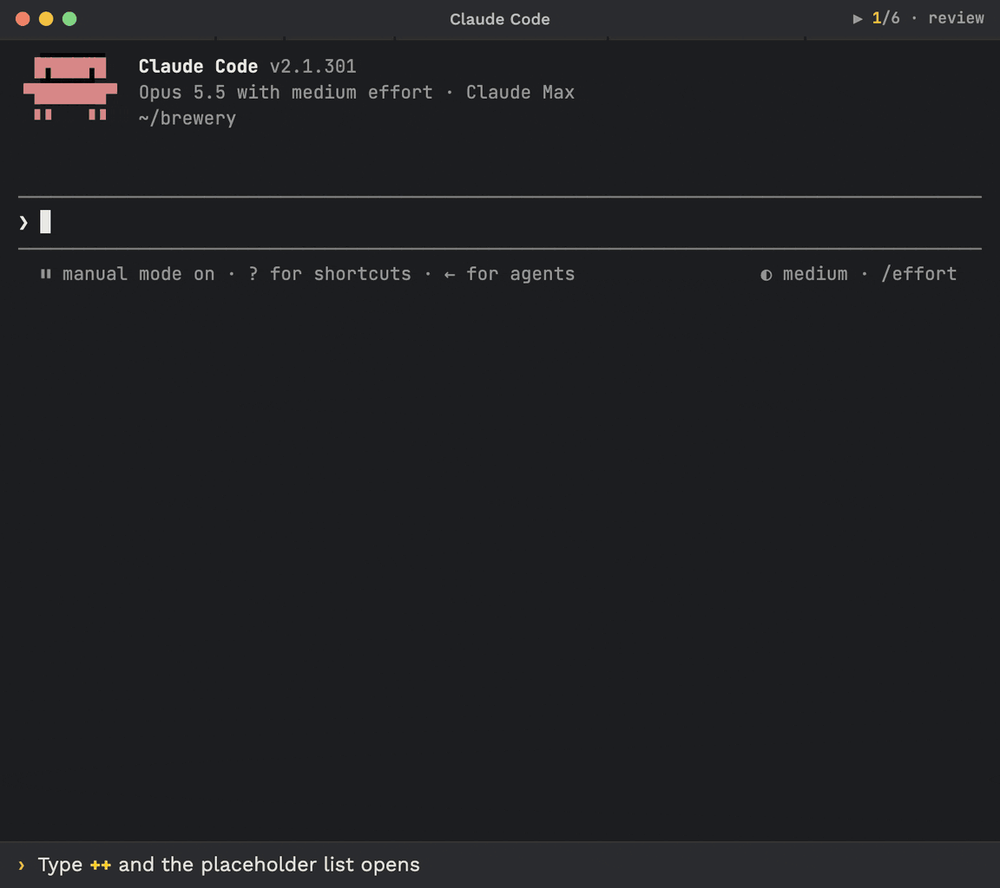

<p align="center">
  
  <br><sub>Illustrative animation: type <code>++</code> → a typeahead lists the names → the band previews the block → an unknown <code>++q</code> warns → <code>Enter</code> sends.</sub>
</p>

<h1 align="center">Prompt placeholders</h1>

<p align="center">Type <code>++r</code>, get a whole instruction block. See it highlighted and previewed before you send.</p>

<p align="center">
  <a href="https://github.com/kochetkov-ma/claude-brewcode/stargazers"></a>
  
  
  
</p>

> Pairs well with [brewmod-plan-effort](../brewmod-plan-effort/). Part of the [brewcode mods](../README.md#claude-code-mods).

## Install

```bash
claude plugin marketplace add https://github.com/kochetkov-ma/claude-brewcode && claude plugin install brewmod-placeholders@claude-brewcode
```

Then run `/reload-plugins`. Works on Team organizations.

<details>
<summary>Update, dev mode, requirements</summary>

```bash
claude plugin marketplace update claude-brewcode && claude plugin update brewmod-placeholders@claude-brewcode
claude --plugin-dir ./brewmod-placeholders   # dev mode, no install
```

- Claude Code **2.1.292+** and `node` on the `PATH` (the bundled command hook runs as plain Node). Builds 2.1.287 to 2.1.291 refuse to load the mod; earlier ones lack the `prompt.autocomplete` event. The `/placeholders` dialog was verified on 2.1.300.
- Mods use the hooks module API, which is early access and can change between releases.
- If you also use brewtools: 6.8.0+, to avoid double injection (see With brewtools).

</details>

## Type this, get that

| You type | You get |
|----------|---------|
| `++r check the diff` | The two-phase review block, added as hidden context. The token stays in your prompt |
| `++` | A typeahead of names. A band above the prompt previews the blocks |
| `/placeholders` | Your placeholders with layer and description, plus how to add one |

## Built-in placeholders

| Token | Adds |
|-------|------|
| `++m` | Manager mode: delegate, never code in the main context |
| `++a` | Architecture first: experts design before implementing |
| `++r` | Two-phase review, then double-check each finding |
| `++rr` | Anti-regression review on three axes |
| `+++` | Anti-drift cron plan (Plan mode only) |

`++rr` beats `++r` when both appear.

## Add your own

Run `/placeholders <what you want>`, for example `/placeholders a ++ship placeholder: release checklist, run tests, update RELEASE-NOTES.md, show me the diff`.

1. Claude proposes a name and a recommendation.
2. It keeps your text verbatim, or drafts it with you.
3. One question asks you to confirm. It saves in your project (global only if you ask).

Change or remove one the same way: `/placeholders change ship`, `/placeholders remove ship`. Then type `++ship` in any prompt.

Prefer plain files? Put `.claude/placeholders/<name>.md` in the directory where you launch Claude Code; the file name is the token name.

```markdown
---
description: "Release checklist"
---
Before tagging: run the full test suite, update RELEASE-NOTES.md, then show me the diff.
```

## Commands

| Command | What it does |
|---------|--------------|
| `/placeholders` (also `status`, `help`, `list`) | Shows the list and usage |
| `/placeholders <what you want>` | Starts the dialog to add, change or remove a placeholder |

## Prompt box

| Feature | Behavior |
|---------|----------|
| Highlight | A known token is coloured and underlined; an unknown prefixed word turns to a warning colour |
| Typeahead | After the prefix, matching names with descriptions. `Tab` inserts the token and a space |
| Band | One row per token. With 1-2 tokens the text expands on its own; with 3+ use `Show text` |
| Toast | On submit, unknown tokens are named, for example `unknown ++q`. The prompt is sent unchanged |

Terminal UI only. Set the prefix in `/config`: the one option, `prefix` (default `++`, 2-8 ASCII punctuation characters).

## Definition files, layers and verification

Front matter keys (`name`, `description`, `insert`, `when`, `order`, `group`, `priority`, `header`, `legacy`) are all optional. Layers, highest wins file by file: project, global, plugin defaults, each with an optional brewtools override. In the same layer the mod's own file wins over the legacy file. Full key table, layers and the verification tables: [definition files](https://doc-claude.brewcode.app/mods/placeholders/#definition-files) and [verified](https://doc-claude.brewcode.app/mods/placeholders/#verified).

<details>
<summary>With brewtools</summary>

brewtools is optional. Since brewtools 6.8.0 it ships no codeword hook, so this mod is the only provider of `++m`, `++a`, `++r`, `++rr` and `+++` in Claude Code.

- **Update brewtools together with the mod.** brewtools 6.7.x with this mod injects each block twice: the mod no longer de-duplicates against brewtools.
- **Overrides carry over.** Prompt overrides under `.claude/brewtools/manager/prompts/` and `<config>/manager/prompts/` are read through the `legacy` key, whatever the brewtools version.

</details>

<details>
<summary>Technical details</summary>

- **Mod tools.** Free-text `/placeholders` requests hand off to Claude with `list_placeholders`, `save_placeholder` and `remove_placeholder`. Saving refuses symlinks and anything that is not a plain file inside the layer; removing never touches plugin defaults or legacy brewtools files.
- **Band keys.** `ctrl+x` is a 3 s chord prefix, `Tab` focuses the button (it does not accept the typeahead), `Enter` toggles without sending, `Esc` returns to the prompt.
- **Team and Enterprise organizations.** The builtin security layer bypasses a mod's `classic.*` hooks, so a bundled command hook (`hooks/inject.mjs`) adds the blocks. Verified on Team-org and Max profiles; Enterprise was not run.
- **Limitations.** A token inserted with `Tab` or a recalled history entry shows no highlight or band until the next keystroke. Drafts over 20,000 characters get no highlight and no band; expansion on submit still works.

[Full technical details](https://doc-claude.brewcode.app/mods/placeholders/#technical-details)

</details>

[Docs](https://doc-claude.brewcode.app/mods/placeholders/) | [Project page](https://brewcode.app/mods/placeholders/) | [Source](https://github.com/kochetkov-ma/claude-brewcode/tree/main/brewmod-placeholders) | [All mods](../README.md#claude-code-mods) | [Release notes](../RELEASE-NOTES.md)

Author: Maksim Kochetkov | License: MIT
