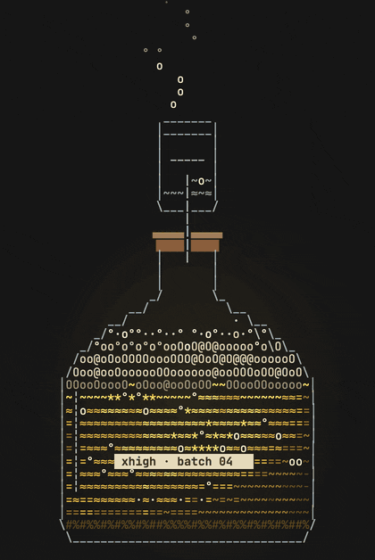
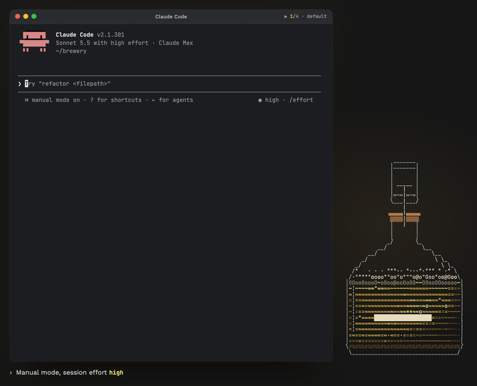

<!-- Stable deep link, shared outside the repo: #demo. Keep the id. -->
<p align="center">
  <a id="demo"></a>
</p>
<p align="center">
  
  <br><sub>Recorded in a real Claude Code 2.1.301 session (session effort <code>high</code>), sped up where the title bar shows ⏩.</sub>
</p>

<h1 align="center">Plan-mode effort</h1>

<p align="center">By default <code>xhigh</code> while Claude plans. Your session effort everywhere else.</p>

<p align="center">
  <a href="https://github.com/kochetkov-ma/claude-brewcode/stargazers"></a>
  
  
  
</p>

> Runs alongside [brewmod-placeholders](../brewmod-placeholders/): the plan-mode row sits above its band. Part of the [brewcode mods](../README.md#claude-code-mods).

## Install

> ❗ **Update Claude Code first:** the mods need Claude Code 2.1.301 or newer. Check with `claude --version`; if it is lower, run `claude update`, then restart Claude Code (exit, run `claude`).

```bash
claude plugin marketplace add https://github.com/kochetkov-ma/claude-brewcode && claude plugin install brewmod-plan-effort@claude-brewcode
```

Then run `/reload-plugins`.

<details>
<summary>Update, dev mode, requirements</summary>

```bash
claude update   # Claude Code 2.1.301+ first, then restart Claude Code
claude plugin marketplace update claude-brewcode && claude plugin update brewmod-plan-effort@claude-brewcode
claude --plugin-dir ./brewmod-plan-effort   # dev mode, no install
```

- Claude Code 2.1.301 or newer.
- Mods use the hooks module API, which is early access.
- `node` on the `PATH` (runs the bundled command hook `hooks/mode.mjs`).
- Update anytime with `/brewtools:plugin-update`.

</details>

## Use it

| You do | You get |
|--------|---------|
| `Shift+Tab` twice from the default mode (`manual mode on` → `accept edits on` → `plan mode on`), or `/plan` | Nothing shows at the keypress itself: Claude Code gives mods no live mode signal, so the mod learns plan mode at the first prompt or tool batch. From that prompt on, requests run at `xhigh`, a row in Claude Code's plan-mode colour (teal) appears above the prompt, and a toast shows once per plan visit |
| `Shift+Tab` out of plan mode | The row disappears at once (about 0.1 s), because the hint line Claude Code draws names the mode just left. The next request is already at your session effort. The status line keeps showing your session effort: the mod raises effort per request and never changes the session setting |
| `Shift+Tab` back into plan mode, then a prompt | A second plan visit: the row and the toast show again |
| Approve the plan | The next request is back at your session effort, nothing to undo |
| `/plan-effort max` | Plan-mode level set to `max`, same as the `planEffort` option in `/config`; the row updates to the new level |

## What you see

| Where | Text | When |
|-------|------|------|
| Toast, 5 s | `brewmod-plan-effort: plan mode · effort raised to xhigh` | Once per plan visit (leaving and re-entering plan mode starts a new one), only when the mod raised the effort |
| No row | | Default or any other mode; before the first prompt of a plan visit; after `Shift+Tab` out of plan mode |

In plan mode the row above the prompt, drawn in Claude Code's plan-mode colour (the `planMode` theme colour: teal on a dark theme, a darker teal on a light one), and the `session` line of the `/plan-effort` status block follow the session effort:

| Session effort | Row above the prompt | `session` line |
|----------------|----------------------|----------------|
| Below `planEffort` (here `high`) | `plan mode · effort xhigh for this mode · change: /plan-effort <level>` | `high   -> raised to xhigh in plan mode` |
| At or above `planEffort` (here `max`) | `plan mode · effort max, already >= xhigh` | `max    not raised, session already >= plan effort` |
| None: the model takes no effort level | `plan mode · effort not raised: model takes no effort level` | `none   not raised, model takes no effort level` |
| A number (here `3`) | `plan mode · effort not raised: 3 is not an effort level` | `3      not raised, 3 is not an effort level` |
| No request seen yet | no row | `n/a until the next request` |

Claude Code adds the `brewmod-plan-effort:` prefix to the toast and to the first line of command output; the mod supplies the text after it.

The row stays through turns and typing, sits above any other prompt-area UI and steps aside while a survey is open. With [brewmod-placeholders](../brewmod-placeholders/) loaded, it stays visible above the placeholders band in either load order. It uses one of the rows the band would otherwise get, so the band below keeps its full layout and does not overflow in fullscreen.

`/plan-effort` prints a status block:

```text
status
plan effort  xhigh  (medium | high | xhigh | max)
session      high   -> raised to xhigh in plan mode
mode now     plan
/plan-effort <level>   set the plan-mode effort
/plan-effort           show this status
```

`plan effort` shows the configured level and the allowed levels; `mode now` is one of:

| `mode now` | Meaning |
|------------|---------|
| `plan` (or the other mode name from the state file) | Mode recorded at the last prompt or tool batch |
| `unknown until the next prompt` | No state file yet |
| `plan mode left (Shift+Tab); known at the next prompt` | You left plan mode by `Shift+Tab`; the new mode is learned at the next prompt |

## Commands

| Command | Result |
|---------|--------|
| `/plan-effort` (also `status`) | The status block above |
| `/plan-effort help` | The status block under the head `help · in plan mode, main-session requests below the plan effort are sent at it; never lowered; subagents and the session effort setting are left alone` |
| `/plan-effort <medium\|high\|xhigh\|max>` | Sets `planEffort` and prints `plan effort: <old> -> <new>` plus the status rows |
| `/plan-effort <other word>` | Prints `unknown '<arg>'` plus the status rows |

`/config` has one option, `planEffort` (default `xhigh`). In `claude -p` there is no `/config` row: the command prints `plan effort: cannot set it here (no /config row, e.g. under -p) · set: /config in an interactive session, or settings.json pluginConfigs`.

## Good to know

- Your session `/effort` setting is never written, and subagents keep their own effort.
- The mod only raises: a session already at or above `planEffort` stays as it is.
- Rejecting a plan keeps the raise, because Claude is still in plan mode.
- Works on Team organizations, where the builtin security layer bypasses `classic.*` hooks.
- Live on Claude Code 2.1.301: row, toast and `Shift+Tab` behaviour 78 of 78 checks over 10 sessions, both mod load orders, 120x40 and 80x24 terminals. Row colour and the placeholders band beside it: 225 of 225 cases of the 6.9.5 live run with both mods loaded (the row in terminal colour `38;5;73` on a dark theme). Unit tests: 71 pass. Earlier measurement on 2.1.300: plan mode sent 4 `xhigh` requests, default mode 0, on Team-org and Max profiles. [Full results](https://doc-claude.brewcode.app/mods/plan-effort/#verified).
- Prompt cache on Claude Code 2.1.301: 15 requests per run, 0 cache misses with and without the mod, and `xhigh` on all 6 plan-mode requests. [Measurement and limits](https://doc-claude.brewcode.app/mods/plan-effort/#verified).

<details>
<summary>Technical details</summary>

- `hooks/mode.mjs`, a bundled command hook on `UserPromptSubmit` and `PostToolBatch`, writes the main loop's `permission_mode` to `<plugin root>/.state/mode-<session_id>.json`; `turn.step` reads it.
- Each request in plan mode is rewritten up to `planEffort`.
- Fails open: errors never block a prompt or tool batch, and a missing state file counts as not in plan mode.
- Entering plan mode is learned at the next prompt or tool batch: no row and no raise before then. Leaving plan mode is read from the prompt hint label.

Full detail: [Technical details](https://doc-claude.brewcode.app/mods/plan-effort/#technical-details). Background: [anthropics/claude-code#91444](https://github.com/anthropics/claude-code/issues/91444).

</details>

[Docs](https://doc-claude.brewcode.app/mods/plan-effort/) | [Project page](https://brewcode.app/mods/plan-effort/) | [Source](https://github.com/kochetkov-ma/claude-brewcode/tree/main/brewmod-plan-effort) | [All mods](../README.md#claude-code-mods) | [Release notes](../RELEASE-NOTES.md)

Author: Maksim Kochetkov | License: MIT
