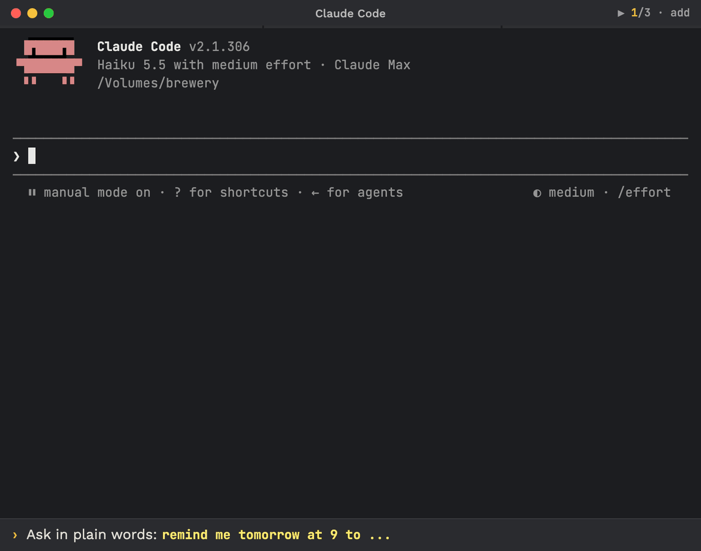

<!-- Stable deep link, shared outside the repo: #demo. Keep the id. -->
<p align="center">
  <a id="demo"></a>
  <br><sub>Recorded in a real Claude Code 2.1.306 session, sped up where the title bar shows ⏩.</sub>
</p>

<h1 align="center">Reminders</h1>

<p align="center">Say what to remember and when. It is a Markdown file, it fires on time, and nothing runs until you say so.</p>

<p align="center">
  <a href="https://github.com/kochetkov-ma/claude-brewcode/stargazers"></a>
  
  
  
</p>

> Part of the [brewcode mods](../README.md#claude-code-mods), next to [brewmod-placeholders](../brewmod-placeholders/) and [brewmod-plan-effort](../brewmod-plan-effort/).

## What it is

`CronCreate` and `/loop` die with the session. A reminder here is a plain Markdown file in the project (`.claude/scheduled/`) or global (every project of your Claude profile). Say it in one sentence, it is saved at once, and any later session shows it when it fires. Nothing runs on its own.

## Install

> **Update Claude Code first:** the mods need Claude Code 2.1.301 or newer (`claude --version`, then `claude update` and restart). The mods use the hooks module API, which is early access.

```bash
claude plugin marketplace add https://github.com/kochetkov-ma/claude-brewcode && claude plugin install brewmod-reminders@claude-brewcode
```

Then run `/reload-plugins`. Needs `node` on the `PATH`. Update with `/brewtools:plugin-update`.

## Timeline

```text
Wed 16:10  "remind me tomorrow at 9 to check the prod logs and show me errors"
           -> saved at once, kind: action
Thu 09:00  it fires. Session closed: nothing happens yet
Thu 09:20  you open a session -> band "reminders · 1 fired"
Thu 09:21  your first prompt -> Claude opens its reply with one line about it
Thu 09:22  **1 -> Claude runs it, closes it with a one-line result -> band gone
Next hour  no repeat line; a newly fired reminder is announced at once
```

Every reminder needs a time or "someday"; if you give none, Claude asks once ("When should it fire?").

## Kinds

- **action**: Claude does the work when you run it ("check the prod logs"), then closes it.
- **note**: only reminds you ("build the CSV export"); shown in full, closed once shown.
- **someday**: no date, never fires; listed only when you ask (`/remind someday`, the `**` picker).

## Commands

| Command | Result |
|---------|--------|
| `/remind` | Fired reminders, numbered like the band |
| `**` / `**1` | Picker of fired reminders / run the first one |
| `/remind all` | Fired, Waiting and Someday |
| `/remind snooze <N\|id> <when>` | New time (`+2h`, `tomorrow 9:00`, `fri 14:00`) |
| `/remind help` | Summary, folders, desktop alert state |

All commands, settings (`prefix`, `cooldownMinutes`, `notify`, `keepDays`, git mode), file format and tools: [full docs](https://doc-claude.brewcode.app/mods/reminders/).

[Project page](https://brewcode.app/mods/reminders/) | [Source](https://github.com/kochetkov-ma/claude-brewcode/tree/main/brewmod-reminders) | [All mods](../README.md#claude-code-mods) | [Release notes](../RELEASE-NOTES.md)

Author: Maksim Kochetkov | License: MIT
