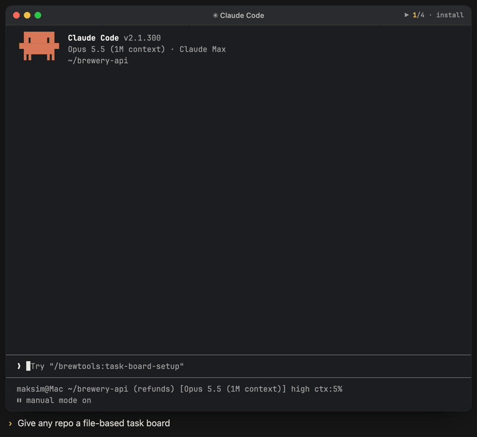

# Task Board Setup

<p align="center"><br><sub>Illustrative animation: install the board → every gate prints OK → view the board → plain files in git.</sub></p>

Installs a file-based task board into any repo: curator agent, `/task-board` skill, lifecycle rule,
per-task methodology and review plans, a derived task graph, and session anti-drift timers.
An optional spec/design layer covers tasks that need explicit decisions. It never commits.

## Install

```bash
claude plugin install brewtools@claude-brewcode
```

## Usage

```text
/brewtools:task-board-setup status
/brewtools:task-board-setup install
/brewtools:task-board-setup install /path/to/repo
/brewtools:task-board-setup upgrade /path/to/repo
```

An existing board defaults to `status`; a fresh target defaults to `install`. A free-text
directive steers the analysis. Afterwards use `/task-board`; `task-tracker` writes only under
`.claude/features/**`.

| Mode | Behavior |
|------|----------|
| `status` | Read-only inventory |
| `install` | Generate into a fresh target; refuse an existing board |
| `upgrade` | Add missing layers and refresh generated controls on an existing board |
| `enable` / `disable` | Restore or park discovery entries without deleting task data |
| `uninstall` | Remove generated machinery; retain task records |
| `purge` | Remove machinery and task data under .claude/features |

| Installed artifact | Purpose |
|--------------------|---------|
| `.claude/agents/task-tracker.md` | Board curator |
| `.claude/skills/task-board/SKILL.md` | View, add, move, backlog, groom; timer ownership |
| `.claude/rules/tasks.md` | Task lifecycle and progress instructions |
| `.claude/features/` | `board.md`, `METHODOLOGY.md`, `ANTI-DRIFT.md`, `task-graph.md`, `PROGRESS.md`, status folders |

An optional, explicitly accepted CLAUDE.md optimization pass is separate from board generation.
It leaves blocks between another tool's begin/end markers (e.g. `<!-- BEGIN brewcode:semble -->`)
untouched, marker lines included, and reports them as `managed by <setup>`.

The `+++` codeword (anti-drift cron for the current task, any mode) comes from the brewmod-placeholders mod (Claude Code 2.1.301+), not
from brewtools.

## Documentation

Full docs: [task-board-setup](https://doc-claude.brewcode.app/brewtools/skills/task-board-setup/)
| [Brewtools overview](../../README.md)
