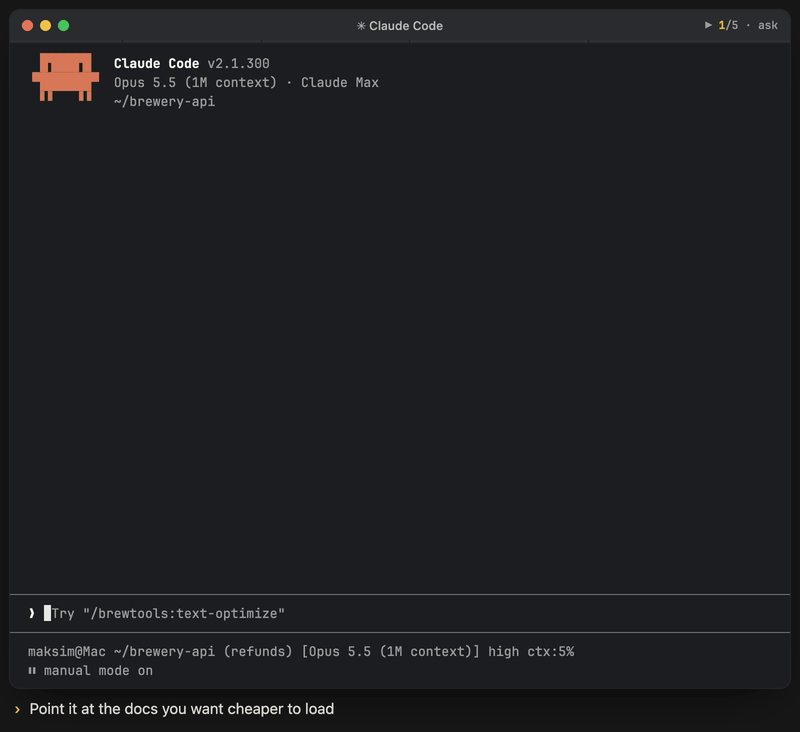

# Text Optimizer

<p align="center"><br><sub>Illustrative animation: prompt → snapshot, one optimizer agent per file → measured before/after report → summary card.</sub></p>

Compress prompts and docs for LLM token efficiency in 5 modes, from light cleanup to deep dictionary encoding. Files are edited in place after a snapshot, and every result is checked against a per-mode loss budget.

## Install

```bash
claude plugin install brewtools@claude-brewcode
```

Model-invocable: type `/brewtools:text-optimize ...` or ask Claude mid-task ("compress this prompt"). Claude-started runs must name target files; `--allow-dirty` authorizes uncommitted ones.

## Usage

```bash
/brewtools:text-optimize CLAUDE.md
/brewtools:text-optimize -s README.md,docs/guide.md
```

| Mode | Flag | Best For | What Changes |
|------|------|----------|--------------|
| **Light** | `-l` | Critical files, production prompts | Filler removal, tone fixes, reference checks — structure untouched |
| **Medium** | _(default)_ | General docs, agents, skills | Tables, bullets, merged sections, full rule set |
| **Standard** | `-s` | README, docs, user-facing content | 30-50% compression preserving human readability. Filler removal, paragraph→bullets, prose→tables. 1 verification round |
| **Deep** | `-d` | CLAUDE.md, system prompts, agent/skill defs | 2-3x compression for LLM-only consumption. Dictionary encoding, symbol substitutions, abbreviation tables, plus aggressive lossy pass (line fusion, word drop, paraphrase, known-fact elision) gated at >=95% semantic match. 1-2 verification rounds |
| **Max** | `-x` | Cost-critical LLM-only prompts (opt-in) | 3-4x. Atomic fact-lines, ASCII operators, Chain-of-Density pass, same aggressive lossy pass as deep (A.1-A.4), same gate. 2 independent verification rounds |

No flag auto-detects: `CLAUDE.md`, rules, agents, skills -> deep; `README.md`, `docs/**` -> standard; unknown or mixed -> asks one question; unanswered or headless -> medium.

## Documentation

Full docs: [text-optimize](https://doc-claude.brewcode.app/brewtools/skills/text-optimize/)
